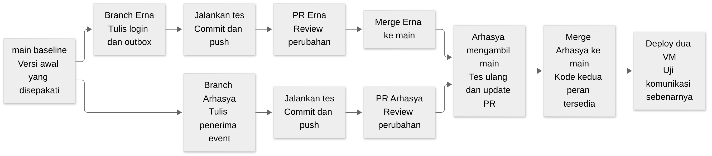

# Menyerahkan pekerjaan melalui Git dan Pull Request

<a href="README.md"><kbd>README</kbd></a> <a href="docs/tugas/erna.md"><kbd>Erna</kbd></a> <a href="docs/tugas/arhasya.md"><kbd>Arhasya</kbd></a> <a href="docs/tugas/bersama.md#menyatukan-pekerjaan"><kbd>Uji bersama</kbd></a>

Git mencatat perubahan file pada clone milikmu. GitHub menyimpan repo bersama agar anggota dapat berbagi perubahan dan memeriksanya. Panduan ini menjelaskan perjalanan satu task coding sampai diterima di `main`, yaitu branch utama repo.

Mulai dari [dasar proyek](docs/tugas/bersama.md#kenali-aplikasi-yang-dibangun) dan [workspace](docs/tugas/bersama.md#folder-dan-terminal) bila kamu belum yakin lokasi terminal atau folder clone. Command di sini dijalankan **di Debian guest, dari `~/LogLab`**. Nama branch contoh harus disesuaikan dengan task yang sedang dikerjakan.

## Memahami alur perubahan



[Sumber Mermaid](docs/architecture/assets/learning/git-journey.mmd). Urutan pada gambar memakai PR Erna lebih dahulu sebagai contoh. PR yang lebih siap dapat masuk lebih dahulu; aturan sinkronisasi berlaku bagi branch yang belum digabung.

Satu **commit** merekam perubahan file yang telah kamu pilih. **Push** mengirim commit ke branch di GitHub. **Pull Request**, disingkat PR, membuka ruang pemeriksaan perubahan sebelum branch digabung ke main. **Merge** adalah penggabungan perubahan file dan riwayat tersebut.

Merge tidak memindahkan atau menyatukan disk VM. Sesudah kode kedua peran digabung, tim masih harus memasang dan menguji kedua layanan dalam satu jaringan integrasi.

## Memulai task dari versi yang benar

Untuk task pertama, gunakan baseline commit yang diberikan integrator menurut panduan workspace. Untuk task berikutnya, pastikan pekerjaan sebelumnya sudah di-commit dan branch yang akan menjadi dasar sudah diterima di main. Lalu jalankan:

```bash
git status --short --branch
git switch main
git pull --ff-only origin main
git switch -c feat/erna-sender
```

Jika status awal menunjukkan perubahan yang belum disimpan, pahami dan selesaikan dahulu sebelum berpindah branch. `pull --ff-only` mengambil main terbaru dengan syarat tidak perlu menggabungkan riwayat lokal yang berbeda. Jika command menolak, laporkan kondisi riwayat kepada integrator sebelum memilih tindakan lain.

Branch baru tetap memakai folder `~/LogLab` yang sama. Erna bekerja pada file Source. Arhasya bekerja pada file Monitor. Perubahan helper, schema, dependency, atau root Makefile dibahas bersama karena perubahan itu dapat memengaruhi kedua sisi.

## Menulis dan memeriksa perubahan

Kerjakan satu hasil yang dapat diuji. Contohnya, PR pertama Erna dapat berisi login dan outbox, sedangkan PR Arhasya berisi penerimaan event. Saat kode berubah, jalankan tes yang sesuai dari runner yang diterbitkan integrator. Catat hasil aktual; jangan mengisi daftar tes sebagai lulus sebelum command dijalankan.

Periksa file yang berubah:

```bash
git status --short
git diff
```

`git status` menunjukkan daftar perubahan. `git diff` memperlihatkan perbedaan isi file yang sudah dilacak. File baru yang belum dilacak perlu dibuka dan diperiksa sendiri karena isinya belum muncul pada diff biasa. Pastikan file yang akan diserahkan berkaitan dengan task dan tidak memuat credential atau database runtime.

## Memilih file dan membuat commit

**Staging** adalah pemilihan perubahan untuk commit berikutnya. Contoh berikut hanya berlaku setelah file E-03 benar-benar dibuat atau diubah:

```bash
git add src/loglab/source_app.py src/loglab/source_service.py tests/test_source.py
git diff --cached
git commit -m "Add source login and durable outbox"
```

`git diff --cached` menunjukkan isi yang akan direkam. Bacalah sebelum commit. Jika Git meminta identitas penulis, atur nama/email Git untuk clone tersebut sesuai identitas kolaborasi yang disepakati. Nama samaran tugas tidak berarti memakai akun GitHub orang lain.

Kamu boleh membuat beberapa commit dalam satu PR ketika setiap commit menjelaskan perubahan yang masuk akal. Pilih pesan yang dapat dipahami reviewer, misalnya “Reject mismatched event receipts”, sehingga masalah yang diperbaiki terlihat dari riwayat.

## Push dan membuka PR

Untuk push pertama pada branch Erna:

```bash
git push -u origin feat/erna-login-outbox
```

Argumen `-u` menghubungkan branch lokal ke branch remote. Push memerlukan akun GitHub dengan izin tulis yang sesuai; integrator harus memeriksa akses anggota pada F-04. Jika autentikasi gagal, tangani akses GitHub tanpa menaruh token pada URL atau berkas repo.

Buka halaman GitHub repo melalui browser. Pilih branch tugasmu lalu buat PR dengan target main. Jelaskan masalah yang dikerjakan, task/requirement terkait, perubahan penting, cara tes, hasil aktual, dan bagian yang belum selesai. Contoh isi PR:

```text
Task: E-03; requirement EP-01, EP-02, EP-05.
Perubahan: login membuat event dan menyimpannya dalam outbox lokal.
Verifikasi: tulis command tes yang benar-benar dijalankan dan hasilnya.
Batas: pengiriman ke Monitor belum termasuk PR ini; dikerjakan pada E-04.
```

Reviewer membaca diff dan dapat meminta perbaikan. Lakukan perbaikan pada branch yang sama, commit, lalu push. PR akan mengikuti commit baru pada branch itu. Setidaknya satu anggota lain meninjau sebelum integrator melakukan merge.

## Mengambil perubahan main ketika PR lain sudah masuk

Misalnya PR Erna masuk lebih dahulu, sementara PR Arhasya masih terbuka. Arhasya mengambil main terbaru ke branch-nya:

```bash
git fetch origin
git switch feat/arhasya-ingest
git merge origin/main
```

`fetch` memperbarui informasi remote. `merge origin/main` memasukkan perubahan main ke branch aktif. Jika tidak ada konflik, jalankan kembali tes yang terdampak lalu push. Reviewer memeriksa keadaan PR yang sudah diperbarui.

Jika Git menandai konflik, artinya dua perubahan pada bagian file tertentu memerlukan keputusan manusia. Buka file yang disebut. Tanda `<<<<<<<`, `=======`, dan `>>>>>>>` memperlihatkan dua versi yang belum dipadukan. Pahami keduanya, pilih atau gabungkan perilaku yang benar, hapus penanda konflik, lalu simpan.

Setelah itu jalankan tes yang terdampak, `git add` file yang sudah diselesaikan, dan `git commit` untuk menyelesaikan merge. Periksa status sebelum push. Jika konflik menyangkut kontrak data atau helper bersama, minta review kedua peran agar resolusi tidak hanya menghilangkan penanda Git tetapi juga menjaga perilaku layanan.

## Kapan sebuah PR diterima

PR diterima setelah perubahan sesuai scope task, pemeriksaan yang relevan lulus, hasilnya dapat ditinjau, dan reviewer menyetujui. Gunakan merge commit sesuai kebijakan tim agar graph riwayat terlihat untuk Modul 5. Proteksi branch dan checks di GitHub masih merupakan pekerjaan konfigurasi integrator; tulisan kebijakan ini belum membuktikan pengaturan server aktif.

PR kecil dapat masuk selama pengerjaan, sehingga Erna dan Arhasya tidak harus menunggu seluruh aplikasinya selesai. Hal ini juga diperlukan saat fitur R-04 sudah diterima: integrator baru dapat menggunakan ekstraktor fitur tersebut untuk training F-05. Audit I-01 di akhir memeriksa bahwa seluruh perubahan yang dibutuhkan sudah masuk dan kompatibel.

## Menyimpan bukti kolaborasi

Bukti Modul 5 berasal dari commit dan PR yang benar-benar dibuat anggota. Simpan task/requirement, command tes, hasil aman, komentar review dan commit penyelesaian. Jika tidak ada konflik alami, lakukan latihan konflik pada branch dan file latihan, lalu tandai sebagai latihan pada laporan. Screenshot VMware harus capture asli dari VMware; output sesi SSH disebut bukti terminal.

Dokumentasi awal di main diterbitkan atas instruksi pemilik. Perubahan coding anggota mengikuti alur branch dan PR di atas.
