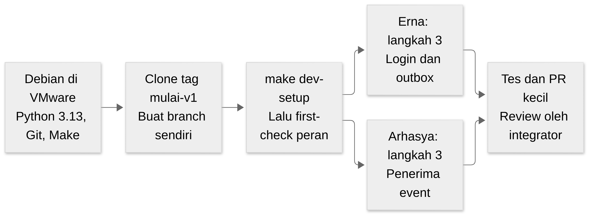
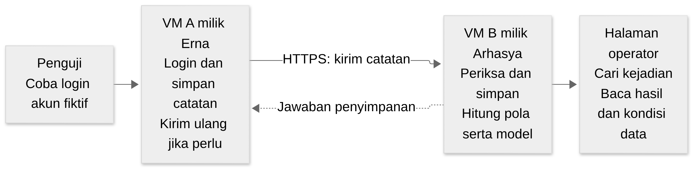
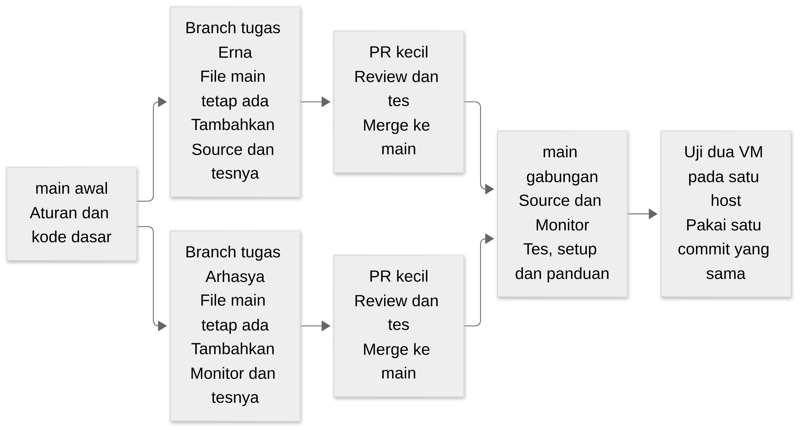

# LogLab

LogLab adalah proyek latihan untuk melihat bagaimana catatan login dikirim, disimpan, dan diperiksa. Penguji mencoba login memakai akun fiktif. Aplikasi mencatat percobaan itu, lalu halaman pemantauan memperlihatkan kejadian dan hasil analisisnya. Dengan proyek ini, tim belajar menulis kode, menguji, menggunakan Git, dan menghubungkan dua aplikasi pada dua VM.

<a href="docs/tugas/erna.md"><kbd>Saya Erna</kbd></a> <a href="docs/tugas/arhasya.md"><kbd>Saya Arhasya</kbd></a> <a href="docs/architecture/BASELINE.md"><kbd>Aturan bersama</kbd></a> <a href="#hasil-aplikasi"><kbd>Hasil yang dituju</kbd></a> <a href="docs/tugas/index.md"><kbd>Daftar tugas tim</kbd></a>

## Bagaimana memakai repo ini

Jika baru bergabung, baca halaman ini sampai bagian pembagian pekerjaan. Sesudah itu buka tombol nama sendiri. Panduan anggota menjelaskan file yang harus dibuat, urutan menulis kode, tes, bentuk hasil branch, dan cara menyerahkan pekerjaan. Kamu tidak perlu memilih dari banyak dokumen untuk mulai.

| Kamu ingin tahu | Buka |
| --- | --- |
| Apa yang harus saya tulis dan hasil akhirnya seperti apa | [Erna](docs/tugas/erna.md) atau [Arhasya](docs/tugas/arhasya.md) |
| Apa aturan OS, alamat, versi dan file bersama | [Aturan dasar proyek](docs/architecture/BASELINE.md) |
| Aplikasi yang selesai harus bisa apa | [Contoh hasil di bawah](#hasil-aplikasi) |
| Bedanya laptop, VM, SSH, folder dan branch | [Folder dan terminal](docs/tugas/bersama.md#folder-dan-terminal) |
| Cara commit, push dan meminta review | [Panduan Git](CONTRIBUTING.md) |
| Kapan pekerjaan dua anggota digabung dan diuji | [Uji bersama](docs/tugas/bersama.md#menyatukan-pekerjaan) |
| Butuh aturan teknis lebih rinci | [Daftar dokumen](docs/index.md) |

## Sudah bisa mulai coding

Fondasi coding sekarang tersedia: fungsi event/config/database/security/backup, contoh event/receipt/status, penerima simulasi untuk tes sender, dependency lock ber-hash dan perintah setup environment. Aplikasi login/pengirim milik Erna dan aplikasi Monitor/dashboard milik Arhasya belum ditulis. Keduanya mulai dari fondasi yang sama melalui tag **`mulai-v1`**. Tag ini titik awal belajar, bukan rilis aplikasi yang sudah selesai.

<a href="config/contract.md"><kbd>Kesepakatan untuk dibaca manusia</kbd></a> <a href="docs/tugas/erna.md#mulai-sekarang"><kbd>Mulai Erna</kbd></a> <a href="docs/tugas/arhasya.md#mulai-sekarang"><kbd>Mulai Arhasya</kbd></a>



[Sumber Mermaid](docs/architecture/assets/learning/mulai-kerja.mmd).

### 1. Siapkan guest Debian

Unduh [Debian 13.7 netinst amd64](https://cdimage.debian.org/debian-cd/13.7.0/amd64/iso-cd/debian-13.7.0-amd64-netinst.iso) dan cocokkan SHA-256 pada [kesepakatan OS](config/contract.md#os-yang-diunduh). Buat/pakai guest yang relevan di VMware laptopmu: Erna 1 CPU/1 GiB RAM/20 GiB disk, Arhasya 2 CPU/2 GiB RAM/20 GiB disk. Buat user `loglab` yang dapat memakai sudo. Petunjuk layar instalasi ada di [panduan bersama](docs/tugas/bersama.md#pasang-debian-sebelum-clone).

Untuk memasang paket dan clone, guest perlu internet melalui NAT sementara. Saat coding, tes memakai database sementara serta data simulasi, sehingga belum membutuhkan VM anggota lain atau secret produksi. Profil IP host-only tetap dipasang dan diuji sebelum menjalankan service akhir. SSH opsional membantu copy-paste; terminal console guest juga cukup untuk langkah di bawah.

### 2. Pasang alat dan clone dari terminal Debian

```bash
sudo apt update
sudo apt install -y python3 python3-venv git make
cd ~
git clone --branch mulai-v1 https://github.com/sedam-or/Log-lab.git LogLab
cd ~/LogLab
```

Clone tag dapat menampilkan pesan detached HEAD. Segera buat branch task berikut agar perubahanmu mempunyai branch sendiri. Jika `~/LogLab` sudah ada, periksa `git remote -v` dan `git status` dahulu; panduan bersama menjelaskan cara memakai clone yang sudah ada tanpa menimpanya.

### 3. Pilih branch sendiri dan siapkan environment

| Orang | Command branch pertama | Pemeriksaan awal sesudah setup |
| --- | --- | --- |
| Erna | `git switch -c feat/erna-login-outbox` | `make first-check ROLE=source` |
| Arhasya | `git switch -c feat/arhasya-ingest` | `make first-check ROLE=monitor` |

Sesudah memilih branch, jalankan:

```bash
make dev-setup
```

Command ini memerlukan Python **3.13**, membuat `.venv`, memasang versi paket beserta hash dari `requirements.lock`, memasang package lokal, memeriksa dependency, lalu menjalankan tes yang tersedia. Jika `.venv` lama memakai Python lain, command berhenti dan meminta pemeriksaan; ia tidak menghapus environment lama. Setup yang sama dapat dijalankan ulang.

Jalankan pemeriksaan awal peran pada tabel. Hasil yang dicari adalah `PASS fondasi source` atau `PASS fondasi monitor`. Itu membuktikan Settings test, DB sementara, fixture dan jawaban simulasi bekerja. Tulisan SIMULASI pada output berarti aplikasi dua VM belum diuji.

### 4. Mulai tugas pertama lalu kirim PR

Erna membuka [langkah 3: login dan penyimpanan](docs/tugas/erna.md#langkah-3). Arhasya membuka [langkah 3: penerima catatan](docs/tugas/arhasya.md#langkah-3). Gunakan fungsi bersama yang sudah ada; tugas pertama tidak menunggu model ML, sertifikat produksi, atau VM anggota lain. Jalankan `make test` setelah mengubah kode dan `make check-contract` sebelum PR. Cara menyerahkan ada di [panduan Git](CONTRIBUTING.md).

Clone dan coding lokal tidak membutuhkan izin push. Jika push ditolak, pemilik repo perlu memberi akses akun GitHub anggota atau menyepakati PR dari fork. Gunakan akun sendiri; jangan membagikan token pemilik.

## Command yang benar-benar tersedia

| Command dari root repo | Yang dikerjakan |
| --- | --- |
| `make dev-setup` | Menyiapkan environment Python 3.13 dan memeriksa fondasi |
| `make first-check ROLE=source` / `ROLE=monitor` | Contoh kecil menggunakan DB sementara dan receiver simulasi |
| `make test` | Menjalankan semua tes yang sudah tersedia dalam `.venv` |
| `make check-contract` | Memeriksa JSON, versi untuk manusia, tabel dan contoh env |
| `make test-contract` | Hanya tes alat pemeriksa konfigurasi |
| `python3 scripts/check_iso.py /path/ke/ISO` | Memeriksa nama dan SHA-256 installer yang sudah diunduh |

`make setup-source` dan `make setup-monitor` belum tersedia: skrip pemasangan service adalah hasil tugas anggota E-05/R-06. `make dev-setup` menyiapkan coding, bukan memasang aplikasi jadi atau membuat VM secara otomatis.

<a id="hasil-aplikasi"></a>

## Ketika aplikasi selesai hasilnya seperti ini

Ada dua aplikasi. **Source**, ditulis Erna, adalah aplikasi login yang menghasilkan catatan kejadian. **Monitor**, ditulis Arhasya, adalah penerima catatan dan halaman pemantauan. Keduanya berjalan pada guest Debian yang berbeda. Guest berarti OS di dalam VM; laptop fisik yang menjalankan VMware disebut host.



[Sumber Mermaid](docs/architecture/assets/learning/hasil-aplikasi.mmd).

Pada demonstrasi akhir, tim harus dapat memperlihatkan urutan berikut:

1. Penguji membuka aplikasi login Source dari browser host dan mencoba akun fiktif dengan password benar atau salah.
2. Source menampilkan hasil login dan mencatat kejadian secara lokal. Setiap kejadian mempunyai identitas sendiri agar dapat ditelusuri.
3. Source mengirim catatan ke Monitor melalui HTTPS. Monitor memeriksa dan menyimpan catatan sebelum memberi jawaban penyimpanan.
4. Source memeriksa jawaban itu. Bila sesuai, pekerjaan ditandai sudah terkonfirmasi; bila jaringan terganggu, catatan yang sudah tersimpan tetap menunggu dan dicoba ulang.
5. Monitor mengelompokkan data yang layak, menghitung aturan pola login dan satu model Logistic Regression yang disiapkan untuk lab. Data belum lengkap atau model gagal ditampilkan dengan alasan, bukan dianggap hasil normal.
6. Operator login pada halaman pemantauan, mencari kejadian, dan membuka data serta hasil yang menjelaskannya.
7. Tim menghentikan Monitor sementara, menghidupkannya kembali, lalu membuktikan catatan pending terkirim tanpa hilang/terhitung dua kali. Reboot dan pemulihan backup juga diperiksa.

Hasil itu adalah tujuan sistem gabungan. Saat menguji sendiri, Erna memakai penerima uji dan Arhasya memakai data contoh yang ditetapkan bersama. Uji dua aplikasi sebenarnya dilakukan setelah kode gabungan dipasang pada satu host integrasi.

## Pembagian pekerjaan untuk tiga orang

| Orang | Kode dan tugas utamanya | Hasil yang diserahkan |
| --- | --- | --- |
| Erna | Login, penyimpanan catatan yang akan dikirim, pengiriman ulang, dan konfigurasi VM A | Kode Source, tes, skrip/konfigurasi pemasangan, dan catatan hasil; [lihat bentuk hasil repo](docs/tugas/erna.md#hasil-branch) |
| Arhasya | Penerimaan catatan, analisis, pemakaian model, halaman operator, dan konfigurasi VM B | Kode Monitor, tes, skrip/konfigurasi pemasangan, dan catatan hasil; [lihat bentuk hasil repo](docs/tugas/arhasya.md#hasil-branch) |
| Penanggung jawab repo | Menetapkan format bersama, menyiapkan fungsi dasar/library/alat uji, melatih model offline, review PR dan mengatur uji gabungan | Fondasi yang dapat dipakai kedua anggota, paket model, satu versi gabungan yang diuji, dan laporan tim |

Istilah teknis untuk penanggung jawab penyatuan adalah *integrator*. Pada tim ini, peran tersebut mengikuti pemilik repo/pemimpin tim sampai nama lain ditetapkan. Anggota memakai akun GitHub masing-masing; nama Erna dan Arhasya adalah samaran tugas. Keduanya tetap menulis kode perannya, bukan hanya memasang VM.

## IP dan nama variabel sudah menjadi kontrak

<a href="docs/interface-contracts/index.md"><kbd>Kontrak IP dan variabel 1.0.0</kbd></a> <a href="config/source.example.env"><kbd>Contoh env Erna</kbd></a> <a href="config/monitor.example.env"><kbd>Contoh env Arhasya</kbd></a>

Baca [config/contract.md](config/contract.md) untuk tabel berbahasa sederhana. [contract.json](config/contract.json) adalah sumber nilainya untuk alat; halaman manusia dihasilkan otomatis dan diperiksa agar tidak berbeda. Kontrak menetapkan IP, port, source ID, nama service/file, endpoint dan variabel `LOGLAB_*`. Contoh env berisi placeholder rahasia, bukan credential siap pakai. `172.16.202.1` adalah alamat adapter host, bukan default gateway internet.

Dari root repo jalankan `make check-contract` (atau `python3 scripts/check_contract.py`) sebelum meminta review. Jalankan `make test-contract` untuk tes alat pemeriksa. Workflow PR/main menjalankan pemeriksaan yang sama. Sesudah provisioning, [petunjuk pemeriksaan env privat dan pasangan](docs/interface-contracts/index.md#periksa-sebelum-meminta-review) mendeteksi typo, placeholder dan token yang tidak cocok tanpa mencetak nilainya. Pengujian aplikasi dua VM tetap dilakukan setelah kode tersedia.

## Aturan yang dipakai bersama

Aturan awal yang disebut baseline adalah kesepakatan agar pekerjaan tidak memakai versi dan format berbeda. Rinciannya ada di [Aturan dasar proyek](docs/architecture/BASELINE.md); berikut hal yang perlu diketahui sebelum mulai:

| Yang disamakan | Arah yang dipakai |
| --- | --- |
| Repo | Satu repo `sedam-or/Log-lab`, dipakai oleh kedua anggota |
| OS guest | Debian 13 amd64 yang sama; installer 13.7.0 dan SHA-256 resmi sudah dicatat di kesepakatan OS |
| Tempat coding | Clone `~/LogLab` di dalam guest anggota masing-masing |
| Host uji akhir | Windows 11 dengan VMware Workstation dan kedua VM pada satu host-only |
| Alamat tetap profil integrasi | Host `172.16.202.1`, Source `.21`, Monitor `.22`; diperiksa tidak bentrok sebelum dipasang |
| Port aplikasi | HTTPS `8443`; SSH `22` untuk akses terminal bila diaktifkan |
| Format catatan/jawaban | Satu [kontrak event](docs/requirements/srs/event-pipeline.md), ditinjau bersama dan diuji dengan contoh yang sama |
| Rahasia dan data hidup | Password/token, private key, database aktif, file VM dan log privat disimpan di luar Git |

SSH direkomendasikan untuk memudahkan copy-paste dari terminal host ke guest. Console VMware tetap dapat dipakai. SSH tidak menghubungkan branch dan tidak menggantikan HTTPS antara Source dan Monitor.

## Seperti apa hasil setiap branch

Branch adalah jalur perubahan Git di dalam repo yang sama. Saat Erna membuat branch, semua file dari main tetap terlihat di clone Erna. Arhasya juga mendapat semua file main. Yang dibedakan adalah **file yang diubah dan hasil kerja yang ditambahkan**, bukan isi repo yang dipangkas menjadi dua aplikasi terpisah.



[Sumber Mermaid](docs/architecture/assets/learning/hasil-branch.mmd).

Contoh PR pertama Erna berisi login/outbox serta tesnya; PR pertama Arhasya berisi penerima catatan serta tesnya. Keduanya tidak harus menyelesaikan seluruh peran pada satu branch panjang. Setelah PR masuk main, branch tugas berikutnya dimulai dari main terbaru. Tabel pada [Erna](docs/tugas/erna.md#hasil-branch) dan [Arhasya](docs/tugas/arhasya.md#hasil-branch) menunjukkan isi setiap PR serta pohon file hasil akhir peran.

Sesudah seluruh PR yang diperlukan diterima, main berisi fondasi bersama, Source, Monitor, tes keduanya, konfigurasi pemasangan, dan panduan yang sesuai. Kedua VM dipasang dari satu commit yang sama, lalu diuji bersama. Git dapat menggabungkan file, tetapi keberhasilan komunikasi aplikasi perlu dibuktikan pada VM.

## Susunan folder

Nama direktori utama mengikuti contoh materi Pertemuan 5. Folder tugas disederhanakan untuk kebutuhan tiga orang.

```text
src/                         kode aplikasi
tests/                       tes dan data contoh aman
config/                      contoh konfigurasi tanpa rahasia
scripts/                     alat bantu pengembangan
deployment/                  pemasangan aplikasi dan service
docs/
  index.md                   peta dokumen teknis
  tugas/
    index.md                 daftar dan status pekerjaan
    erna.md                  langkah dan hasil Source
    arhasya.md               langkah dan hasil Monitor
    bersama.md               pengenalan, folder/SSH dan uji bersama
  requirements/              tujuan produk dan aturan sistem
  architecture/              aturan lingkungan, standar dan gambar
  interface-contracts/       contoh/schema komunikasi bersama
  history/                   asal dokumen dan konteks lama
```

[Mulai tugas Erna](docs/tugas/erna.md) · [Mulai tugas Arhasya](docs/tugas/arhasya.md) · [Lihat status tim](docs/tugas/index.md)
