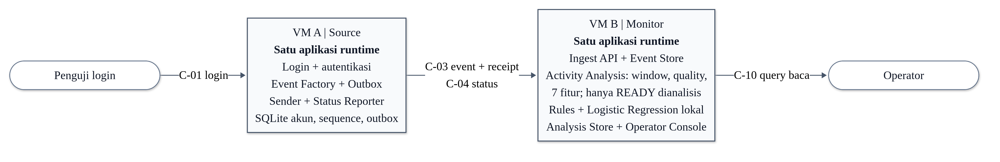
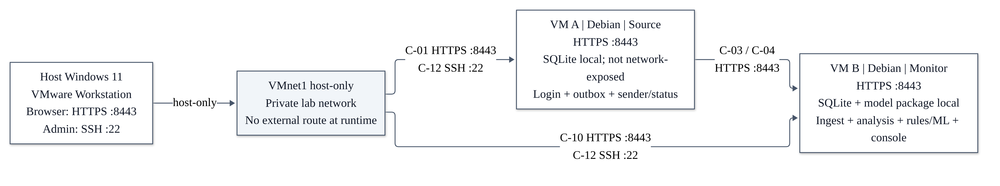

# Arsitektur

Baca [baseline](BASELINE.md) untuk lingkungan, batas tanggung jawab dan status kesiapan. Lalu baca [sistem dan komunikasi](../requirements/srs/system.md) serta [standar implementasi](standards.md).

## Diagram yang sudah tersedia

Diagram dari paket Modul 3 dipertahankan bersama sumber Mermaid. Gambar menunjukkan dua peran runtime, bukan dua repo.

[Sumber diagram logis](assets/logical-architecture.mmd).

[Sumber deployment](assets/physical-deployment-architecture.mmd).

Label diagram berasal dari paket Modul 3: C-01 adalah login, C-03 pengiriman event/receipt, C-04 status sumber, C-10 akses console/query, C-12 administrasi SSH. Label C adalah kode aliran pada gambar, berbeda dari ID requirement EP/AA/ML/UI/OP. Detail request dan response mengikuti SRS, bukan angka C semata.

[Daftar assets](assets/index.md) memuat sumber dan status. Diagram adalah dokumentasi rancangan; bukan screenshot evidence VM.

Untuk memahami proses coding sebelum membaca diagram sistem, buka [diagram belajar](assets/learning/index.md) atau [dasar proyek](../tasks/basics.md).
