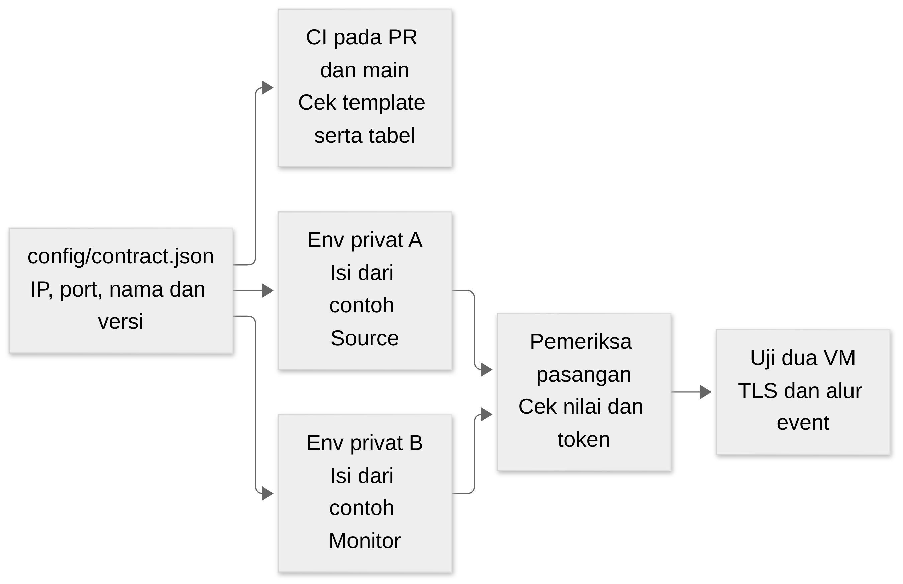

# Kontrak parameter kedua VM

<a href="../../README.md"><kbd>README</kbd></a> <a href="../architecture/BASELINE.md"><kbd>Aturan bersama</kbd></a> <a href="../tugas/erna.md"><kbd>Erna</kbd></a> <a href="../tugas/arhasya.md"><kbd>Arhasya</kbd></a>

**Ditetapkan 29 Oktober 2026 atas arahan pemilik.** Kontrak ini mengikat parameter jaringan, nama proses/file, variabel konfigurasi dan nama endpoint pada repo baru. Erna dan Arhasya mengikuti nilai yang sama; perubahan yang memengaruhi keduanya masuk melalui PR bersama dan menaikkan versi kontrak.

Sumber nilai yang dibaca alat adalah [config/contract.json](../../config/contract.json). Tabel di bawah dan kedua contoh env diturunkan dari file tersebut; pemeriksa menolak tabel/template yang tertinggal. Ini kontrak konfigurasi versi 1.0.0, berbeda dari versi produk pada PRD dan `schema_version=1` pada event. Menetapkan kontrak tidak menyatakan aplikasi/VM sudah terpasang atau diuji.



[Sumber Mermaid](../architecture/assets/learning/kontrak-parameter.mmd). Secret tidak masuk CI; mode pasangan dijalankan oleh integrator pada salinan privat yang berwenang.

<!-- CONTRACT-TABLES:START -->

Versi kontrak: **1.0.0**. Profil: **vmware-host-only**.

| Parameter | Nilai yang disepakati |
| --- | --- |
| Jaringan host-only | `172.16.202.0/24`, `VMnet1` |
| Alamat adapter host | `172.16.202.1`; bukan default gateway |
| HTTPS / SSH | `8443` / `22` |
| Folder clone / virtualenv | `/home/loglab/LogLab` / `/home/loglab/LogLab/.venv` |
| User guest / service | `loglab` / `loglab-svc` |

| Peran | IP dan hostname | Service dan entrypoint | Env privat dan DB |
| --- | --- | --- | --- |
| Erna / source | `172.16.202.21`; `loglab-source` | `loglab-source.service`; `loglab.source_main:app` | `/etc/loglab/source.env`; `/var/lib/loglab/source.sqlite3` |
| Arhasya / monitor | `172.16.202.22`; `loglab-monitor` | `loglab-monitor.service`; `loglab.monitor_main:app` | `/etc/loglab/monitor.env`; `/var/lib/loglab/monitor.sqlite3` |

| Variabel wajib | Source | Monitor | Nama pada Settings Python | Arti |
| --- | --- | --- | --- | --- |
| `LOGLAB_CONTRACT_VERSION` | `1.0.0` | `1.0.0` | `contract_version` | Versi kontrak konfigurasi |
| `LOGLAB_PORT` | `8443` | `8443` | `port` | Port HTTPS, dibaca sebagai integer |
| `LOGLAB_SOURCE_ID` | `login-lab-a` | `login-lab-a` | `source_id` | Identitas sumber yang harus sama pada A dan B |
| `LOGLAB_CA_BUNDLE` | `/etc/loglab/ca.crt` | `/etc/loglab/ca.crt` | `ca_bundle` | CA publik untuk memverifikasi TLS |
| `LOGLAB_TLS_CERT` | `/etc/loglab/tls.crt` | `/etc/loglab/tls.crt` | `certfile` | Sertifikat milik guest ini |
| `LOGLAB_TLS_KEY` | `/etc/loglab/tls.key` | `/etc/loglab/tls.key` | `keyfile` | Private key milik guest ini; isi tidak dibagikan |
| `LOGLAB_ROLE` | `source` | `monitor` | `role` | Peran proses, bukan nama anggota |
| `LOGLAB_BIND_HOST` | `172.16.202.21` | `172.16.202.22` | `bind_host` | IP privat tempat Uvicorn mendengarkan |
| `LOGLAB_DB_PATH` | `/var/lib/loglab/source.sqlite3` | `/var/lib/loglab/monitor.sqlite3` | `db_path` | Database lokal per peran |
| `LOGLAB_MONITOR_URL` | `https://172.16.202.22:8443` | Tidak dipakai | `monitor_url` | Origin Monitor tanpa path dan trailing slash |
| `LOGLAB_SENDER_LOCK` | `/run/loglab/sender.lock` | Tidak dipakai | `sender_lock` | File lock untuk satu sender |
| `LOGLAB_MODEL_PATH` | Tidak dipakai | `/var/lib/loglab/model.json` | `model_path` | Paket model numerik; sidecar checksum menambah .sha256 |
| `LOGLAB_OPERATOR_USERNAME` | Tidak dipakai | `operator` | `operator_username` | Akun operator lab, password disiapkan privat |
| `LOGLAB_SOURCE_TOKEN` | Rahasia: `hex64` | Rahasia: `hex64` | `source_token` | Token acak 32 byte hex lowercase, nilai sama di A dan B |
| `LOGLAB_PSEUDONYM_KEY` | Rahasia: `hex64` | Tidak dipakai | `pseudonym_key` | Key HMAC 32 byte hex lowercase, hanya diperlukan Source |
| `LOGLAB_OPERATOR_PASSWORD_HASH` | Tidak dipakai | Rahasia: `scrypt` | `operator_password_hash` | Hash scrypt operator; password mentah tidak masuk env |

| Endpoint | Method | Alamat |
| --- | --- | --- |
| `source_login_form` | `GET` | `https://172.16.202.21:8443/login` |
| `source_login_form_submit` | `POST` | `https://172.16.202.21:8443/login` |
| `source_login_submit` | `POST` | `https://172.16.202.21:8443/api/v1/login` |
| `monitor_events` | `POST` | `https://172.16.202.22:8443/api/v1/events` |
| `monitor_status` | `POST` | `https://172.16.202.22:8443/api/v1/source-status` |
| `dashboard` | `GET` | `https://172.16.202.22:8443/` |
| `source_health` | `GET` | `https://172.16.202.21:8443/health` |
| `monitor_health` | `GET` | `https://172.16.202.22:8443/health` |

| Aturan masuk TCP baru | Yang diizinkan |
| --- | --- |
| `source` | `172.16.202.1: [22, 8443]` |
| `monitor` | `172.16.202.1: [22, 8443]; 172.16.202.21: [8443]` |

<!-- CONTRACT-TABLES:END -->

## Apa yang tetap dan apa yang dibuat saat pemasangan

IP, port, hostname, nama service, source ID, URL, nama variabel dan path pada kontrak merupakan nilai tetap untuk profil integrasi. Instance A/B berada pada satu host-only tanpa default gateway internet. `172.16.202.1` adalah alamat adapter host, **bukan** gateway yang dipasang sebagai default route guest. NAT boleh dipakai sementara untuk clone/paket, lalu dinonaktifkan sebelum uji runtime.

Pilih adapter berdasarkan jaringan/MAC yang benar pada guest. Nama interface seperti `ens33` atau `ens37` tidak dibekukan karena dapat berbeda antarinstalasi. Firewall/provisioning harus menemukan atau menerima interface yang sesuai, lalu memeriksa alamat aktual. Jika subnet bertabrakan dengan jaringan laptop, catat konflik dan ubah profil melalui PR bersama; jangan mengganti IP hanya pada branch satu anggota.

Rahasia tidak dibekukan menjadi satu password publik. Buat `LOGLAB_SOURCE_TOKEN` secara acak satu kali untuk satu pasangan lab, lalu pasang **nilai yang sama** pada A dan B melalui jalur privat. Buat HMAC key Source sekali dan pertahankan pada setup ulang agar pseudonim/data lama konsisten. Monitor tidak membutuhkan HMAC key karena menerima pseudonim yang sudah dibuat A. Password operator hanya ada pada catatan privat; env Monitor menyimpan hash, bukan password mentah.

Secret hex menggunakan 32 byte acak yang ditulis menjadi 64 karakter hex lowercase. Hash operator memakai `scrypt$16384$8$1$<salt-16-byte-hex>$<hash-32-byte-hex>`. Contoh env berisi placeholder yang sengaja tidak lulus pemeriksaan runtime. Nilai sah menurut bentuk bukan bukti bahwa secret dibuat acak; installer tetap wajib memakai generator acak yang sesuai.

Event ID dan stream ID memakai UUID yang dibuat saat runtime sesuai SRS, bukan ID tetap yang disalin ke semua run. `source_id` tetap `login-lab-a`; stream disimpan bersama DB dan tidak dibuat ulang pada reboot biasa. Waktu event memakai UTC RFC 3339 berakhiran `Z`. Nama field JSON memakai `snake_case`, sesuai [kontrak event](../requirements/srs/event-pipeline.md), termasuk `acknowledged_sequence`; alias seperti `acked_sequence` bukan nama wire yang diterima.

## Konfigurasi contoh dan cara membacanya

- Erna mulai dari [source.example.env](../../config/source.example.env) dan memasangnya ke `/etc/loglab/source.env` lewat installer.
- Arhasya mulai dari [monitor.example.env](../../config/monitor.example.env) dan memasangnya ke `/etc/loglab/monitor.env` lewat installer.

Kedua contoh memakai nama variabel persis pada tabel. `MONITOR_IP`, `MONITOR_URL` tanpa prefix, atau `LOGLAB_HOST` bukan alias yang diterima. Seluruh key peran wajib ada dan key tak dikenal/keliru peran harus ditolak saat startup. Nama Settings Python pada tabel menjadi interface bersama yang ditulis integrator di `config.py`. `source_main`/`monitor_main` harus menolak LOGLAB_ROLE yang tidak cocok dengan entrypoint-nya. Port dibaca sebagai integer, path sebagai Path dan HMAC key diubah dari hex menjadi bytes setelah validasi. Tidak boleh diam-diam memakai nilai default berbeda pada Source/Monitor.

Format env adalah `NAMA=nilai` literal, satu per baris, tanpa `export`, quote, substitusi shell atau inline comment. `$` pada hash scrypt dipertahankan sebagai karakter literal. File env **tidak dijalankan** memakai shell `source`; systemd/loader memasukkannya sebagai konfigurasi. Baris komentar terpisah diawali `#`. Setup wajib membaca `LOGLAB_BIND_HOST`, `LOGLAB_PORT` dan path TLS untuk launcher Uvicorn; deklarasi variabel saja tidak membuat Uvicorn otomatis memakainya.

Private directory `/etc/loglab` memakai owner/group `root:loglab-svc` mode `0750`. File env dan akun uji dimiliki root mode `0600`; systemd membaca env sebelum service berjalan sebagai `loglab-svc`. Private key TLS hanya dapat dibaca root dan grup service, mode `0640`. Folder data dimiliki `loglab-svc:loglab-svc`, mode `0700`. Instalasi memberi service akses baca/traverse pada source/virtualenv di `/home/loglab/LogLab`, tanpa membuka `.ssh` atau shell history. Uji akses sebagai akun service sebelum menyatakan startup siap.

Path `/opt/loglab` dan symlink ke laptop lama tidak diperlukan pada repo baru. Sertifikat/key masing-masing guest berbeda; keduanya diterbitkan CA lab yang sama. SAN Source mencakup IP `.21`, SAN Monitor mencakup `.22`; menggunakan hostname pada URL memerlukan SAN tambahan dan revisi kontrak. CA private key tidak disalin ke kedua VM. CA publik yang dipasang pada A, B dan browser host harus cocok; verifikasi TLS/SAN tetap wajib saat uji koneksi.

## Nama akun dan layanan

Nama VM di VMware adalah `LogLab-Source-Erna` dan `LogLab-Monitor-Arhasya`; hostname Debian adalah `loglab-source` dan `loglab-monitor`. User SSH guest adalah `loglab`, sedangkan proses aplikasi berjalan sebagai `loglab-svc`. Akun operator web adalah `operator`. Akun login uji Source minimal `demo-user-01` dan `demo-user-02`, dengan password privat yang dibuat saat provisioning; daftar input seed berada pada `/etc/loglab/test-accounts.json` dan tidak dikomit.

Satu aplikasi runtime dijalankan per guest melalui entrypoint pada tabel. Source memiliki satu sender; Monitor memiliki satu loop analisis. Service aplikasi aktif saat guest boot. Menyalakan VM setelah **host** boot adalah konfigurasi terpisah dan tidak otomatis dijamin oleh service guest.

## Alamat dan nama endpoint

Alamat endpoint pada tabel di atas dihasilkan dari JSON. Port database tidak dibuka. Firewall menerima loopback dan koneksi balasan yang sudah sah; koneksi TCP baru hanya mengikuti tabel. A tidak menerima koneksi baru dari B, dan SSH guest dibatasi dari alamat adapter host. Pemilihan interface firewall harus sesuai adapter aktual.

`LOGLAB_MONITOR_URL` hanya berisi origin `https://172.16.202.22:8443`, tanpa `/api` atau trailing slash. Sender menambahkan path endpoint, memakai bearer token sumber dan memverifikasi TLS. Receipt event sukses memakai HTTP 200 dan field tepat `status`, `source_id`, `event_id`, `event_digest`; `status` hanya `stored` atau `duplicate`. Receipt diberikan sesudah commit, dan A membandingkan identitas/digest sebelum ACK.

Respons `/health` memuat `service` (`loglab-source` atau `loglab-monitor`), `state=ready` untuk liveness dan `contract_version=1.0.0`. Respons ini tidak membuktikan outbox selesai, model tersedia, data READY, atau restore lulus. Form browser Source memakai `POST /login` dengan form-urlencoded `username` dan `password`. Endpoint `POST /api/v1/login` menerima JSON dengan nama field yang sama untuk alat uji. Pembatasan ukuran serta proteksi request tetap mengikuti SRS; dua jalur ini tidak boleh menghasilkan format event berbeda.

Nama variabel dan endpoint di sini wajib dipakai kode baru; detail event/error/retry dan data analisis tetap mengikuti SRS. Tidak semua usulan di lampiran SRS disahkan oleh kontrak parameter ini.

## Periksa sebelum meminta review

Alat pemeriksa berikut sudah tersedia dan hanya membutuhkan Python standard library. Dari root repo:

```bash
python3 scripts/check_contract.py
# Atau jika Make tersedia:
make check-contract
```

Command ini memeriksa manifest publik, contoh env dan tabel dokumentasi. Template boleh berisi placeholder pada mode ini, karena belum menjadi konfigurasi runtime. Exit code 0 berarti pemeriksaan konfigurasi yang diminta lulus; 1 berarti tidak cocok; 2 berarti cara memakai argumen salah.

Sesudah installer memasang env privat, jalankan pada guest yang bersangkutan:

```bash
# Erna, pada guest Source:
sudo python3 scripts/check_contract.py --role source --env /etc/loglab/source.env
# Arhasya, pada guest Monitor:
sudo python3 scripts/check_contract.py --role monitor --env /etc/loglab/monitor.env
```

Mode runtime menolak key tak dikenal/hilang, nilai tetap yang berbeda, secret placeholder dan format secret salah. Pesan gagal menyebut key atau kategori, tanpa mencetak nilainya. Installer/loader baru harus memanggil pemeriksaan setara sebelum menyalakan service; parser aplikasi belum tersedia hari ini.

Untuk memeriksa dua env, integrator memerlukan salinan privatnya pada satu mesin yang berwenang. Gunakan path yang benar dan simpan salinan tersebut di luar clone. Bentuk command berikut adalah contoh path, bukan file yang sudah dibuat repo:

```text
python3 scripts/check_contract.py --source-env /private/source.env --monitor-env /private/monitor.env
```

Mode pasangan membandingkan token secara konstan-waktu setelah kedua konfigurasi divalidasi. Tambahkan `--source-ca /private/source-ca.crt --monitor-ca /private/monitor-ca.crt` untuk memastikan salinan CA publik identik berdasarkan hash. Pemeriksaan hash CA bukan validasi trust chain/SAN. Jangan mengirim env privat lewat PR atau menampilkan nilai saat membandingkan. Bila akses ke dua env belum tersedia, tandai pemeriksaan pasangan belum dilakukan, bukan lulus berdasarkan pemeriksaan satu peran.

## Mengubah kontrak

Ubah nilai pada JSON hanya melalui PR bersama. Jelaskan alasan, versi sebelum/sesudah, anggota yang terdampak dan pengujian ulang. Setelah keputusan baru diterima, naikkan versi kontrak lalu jalankan `python3 scripts/check_contract.py --sync` untuk menghasilkan ulang contoh dan tabel; perubahan buatan tangan pada contoh/tabel akan ditolak pemeriksa.

Gunakan kenaikan major untuk mengganti IP/port/path/nama variabel atau makna yang membuat deployment lama tidak kompatibel. Perbaikan penjelasan tanpa perubahan nilai tidak memerlukan versi baru; perubahan kompatibel pada kontrak tetap direview dan diberi minor/patch yang sesuai. Pemeriksa tidak menyetujui perubahan JSON atau menggantikan review versi; ia mendeteksi ketidaksesuaian hasil turunan dan env.

Aturan yang baru dipastikan: key HMAC hanya pada Source; bind/port berasal dari konfigurasi; alamat adapter host bukan default gateway; dan file secret/env mempunyai izin menurut peran. Loader lama yang meminta key HMAC di Monitor serta unit yang mengunci IP di command perlu diadaptasi saat migrasi. ISO/hash instalasi, dependency lock aktual, paket model/hash dan versi Workstation hasil uji masih perlu bukti tersendiri; tidak diisi dengan nilai tebakan.

[← Kembali ke tugas Erna](../tugas/erna.md) · [Tugas Arhasya](../tugas/arhasya.md) · [Aturan dasar](../architecture/BASELINE.md)

## Pemeriksaan otomatis pada GitHub

Workflow `contract.yml` menjalankan pemeriksa repo dan tes alatnya pada PR serta push main. Job ini tidak memakai secret deployment dan tidak menguji service VM. Pengaturan required check pada proteksi main merupakan pengaturan repo terpisah; keberadaan workflow tidak otomatis memblokir tombol merge. Hasil run aktual diperiksa setelah workflow dikirim.
