# Spesifikasi kebutuhan sistem

Draf adaptasi dari SRS v0.1.0 tanggal 14 Oktober 2026. Struktur dipecah agar Erna dan Arhasya dapat membaca bagian yang berkaitan dengan tugasnya. Nomor bagian dan ID requirement sumber dipertahankan. Pemecahan ini tidak mengesahkan usulan pada lampiran dan tidak menyatakan repo baru telah lulus acceptance.

[PRD](../PRD.md) mengendalikan tujuan dan scope. SRS menjelaskan kontrak teknis di dalam scope tersebut. Target Windows 11 dan struktur `deployment/` mengikuti arah kerja repo pada 28 Oktober; implementasi baru tetap perlu diperiksa terhadap kontrak.

| Baca | Isi dan pembaca utama |
| --- | --- |
| [Istilah](terms.md) | Arti EP, AA, ML, UI, OP, event, receipt, dan istilah lain; baca sebelum tugas teknis |
| [Sistem dan komunikasi](system.md) | Peran kedua VM dan pertukaran data; semua anggota |
| [Event pipeline](event-pipeline.md) | EP-01–EP-07, field JSON, transaksi, receipt dan retry; Erna serta Arhasya |
| [Analisis aktivitas](activity-analysis.md) | AA-01–AA-05, window, kualitas, dan fitur; Arhasya bersama integrator |
| [Classifier](ml-classifier.md) | ML-01–ML-06, dataset, seed, model dan batas klaim; integrator menyiapkan, Arhasya memverifikasi runtime |
| [Dashboard](operator-console.md) | UI-01–UI-05, sesi, pencarian, hasil dan kondisi data; Arhasya |
| [Operasi](lab-operations.md) | OP-01–OP-06, instalasi ulang, backup, profil uji; semua anggota |
| [Verifikasi](verification.md) | Requirement dan bukti yang diperlukan |
| [Usulan lama](proposals.md) | Keputusan teknis yang belum otomatis disahkan; dibaca saat review desain |

Rujukan seperti “Bagian 5.1” pada dokumen sumber menunjuk file Event pipeline; tabel di atas menjadi peta nomor bagian. Workbook/PDF lama masih perlu diselaraskan dan tidak mendahului Markdown ini. Perubahan kontrak bersama dicatat melalui PR integrator sebelum dipakai kedua anggota.

[Sumber diagram](../../architecture/assets/SRS_PETA_KEMAMPUAN.mmd).

Parameter jaringan, nama service/path, env dan endpoint dibekukan pada [kontrak parameter 1.0.0](../../interface-contracts/index.md). Untuk scope parameter tersebut, JSON kontrak dan tabel turunannya mengendalikan nilai. SRS lain serta usulan lama tetap memiliki status review masing-masing; konfigurasi dibekukan tidak berarti aplikasi sudah diuji.
