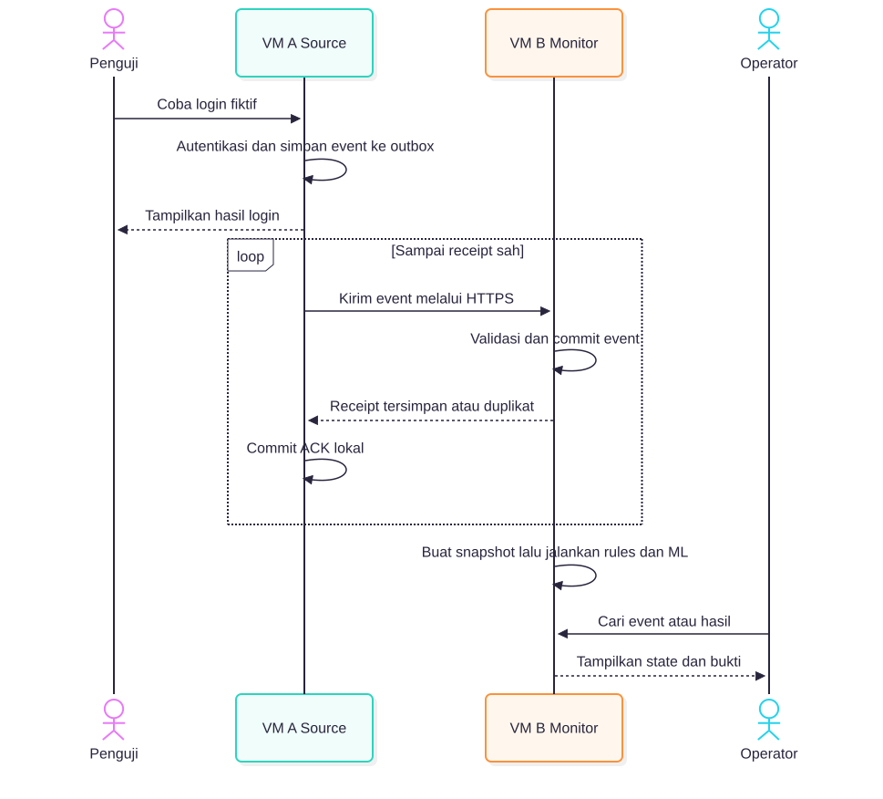

> Draf adaptasi dari SRS v0.1.0 lama. ID requirement dan nomor bagian dipertahankan untuk traceability. Bukti implementasi lama bukan hasil uji repo ini. [Indeks SRS](index.md).

## 3. Konteks sistem dan arsitektur

Target integrasi LogLab adalah host Windows 11 melalui VMware Workstation. Laptop pengembangan anggota dapat berbeda OS host; guest tetap Debian target. VM A menjalankan aplikasi login dan pengiriman event; VM B menerima event, menganalisis aktivitas, dan menyajikan dashboard. Host membuka kedua aplikasi melalui jaringan host-only. Database tetap berada di VM yang menggunakannya dan tidak diekspos sebagai layanan jaringan.

### 3.1 Bentuk sistem dan tanggung jawab VM

| Komponen | Perangkat lunak dan data | Tanggung jawab dan batas |
| --- | --- | --- |
| **Host Windows 11** | VMware Workstation yang sudah tersedia; browser operator; arsip evidence di direktori privat. | Menyalakan dua guest dan menjadi endpoint akses host-only. Bukan bagian dari jalur ingest. Rahasia dan arsip runtime tidak masuk Git. |
| **VM A - Source** | Debian 13.x; aplikasi login FastAPI; akun fiktif; SQLite untuk akun, stream/sequence, outbox, dan counter; satu sender; sertifikat TLS. Profil awal 1 vCPU, RAM 1 GiB, disk virtual dinamis 20 GiB. | Memutuskan hasil login, membuat event sekali, commit ke outbox, lalu mengirim A→B. Tidak menyimpan model, menghitung rules, atau bergantung pada ketersediaan B untuk menjawab login. |
| **VM B - Monitor** | Debian 13.x; API ingest dan dashboard FastAPI; satu SQLite lokal untuk event, receipt, heartbeat, snapshot, rules, hasil inferensi, sesi operator; satu loop analisis; satu paket Logistic Regression; sertifikat TLS. Profil awal 2 vCPU, RAM 2 GiB, disk virtual dinamis 20 GiB. | Menerima event dan heartbeat dari A, menyimpan secara idempoten, menganalisis snapshot, serta menyajikan bukti kepada operator. Database hanya dibaca proses lokal B dan tidak membuka port database ke jaringan. |

### 3.2 Komponen dan komunikasi dua VM



Sumber diagram: [`SRS_VM_DAN_KOMUNIKASI.mmd`](../../architecture/assets/SRS_VM_DAN_KOMUNIKASI.mmd).

Guest dipasang dari ISO Debian 13 amd64 yang sama; nama ISO dan SHA-256 final ditetapkan integrator sebelum panduan instalasi dibagikan. Riwayat template/reset lama hanya berlaku untuk implementasi historis. Jaringan memakai VMware host-only `vmnet1`, subnet `172.16.202.0/24`, A `172.16.202.21`, B `172.16.202.22`, dan alamat adapter host `172.16.202.1`. Alamat diperiksa bebas sebelum provisioning. Kedua layanan memakai HTTPS pada port `8443`; runtime tidak memiliki default route internet. NAT hanya boleh aktif sementara saat instalasi paket, lalu dimatikan sebelum acceptance.

Sebelum menjalankan kedua VM, memori tersedia host (Task Manager Windows atau `MemAvailable` Linux) harus sekurang-kurangnya 5 GiB (3 GiB alokasi guest + 2 GiB ruang host), dan proyeksi ruang disk setelah VM, database, backup, serta evidence harus menyisakan sekurang-kurangnya 15% filesystem. Nilai ini diperiksa ulang; snapshot host saat ini bukan hasil uji berbeban.

## 4. Alur komunikasi dan interface

Bagian ini menjelaskan urutan lintas proses. Event dikomit pada VM A sebelum login menjawab; pengiriman dan acknowledgment dapat pulih setelah gangguan. VM B menyimpan event sebelum receipt, lalu analisis berjalan terpisah sehingga tidak menahan login atau acknowledgment.



Sumber diagram: [`SRS_ALUR_EVENT.mmd`](../../architecture/assets/SRS_ALUR_EVENT.mmd).

Field, validasi, response, dan aturan retry terperinci ditetapkan oleh requirement Event Pipeline pada [kontrak event](event-pipeline.md).

### 4.1 Alur komunikasi dan kontrak

```text
Browser host --HTTPS--> VM A login
Browser host --HTTPS--> VM B dashboard
VM A sender   --HTTPS--> VM B ingest
VM B          --tidak mengirim perintah atau keputusan blokir--> VM A
```

- Browser membuka `https://172.16.202.21:8443/` untuk login uji dan `https://172.16.202.22:8443/` untuk dashboard. Sertifikat lab memiliki SAN untuk kedua alamat; CA lokal dipasang pada host/browser dan VM yang memverifikasi B.
- A mengirim satu event dengan `POST /api/v1/events`, bearer token sumber, dan satu JSON event maksimal 8 KiB. B memverifikasi token, schema, digest, kapasitas, identitas event, dan sequence. B commit lebih dahulu, lalu mengembalikan receipt berisi `status`, `source_id`, `event_id`, dan `event_digest`. `stored` menandakan insert baru; `duplicate` hanya berlaku untuk digest identik. ID sama dengan digest/isi berbeda menghasilkan konflik `409` dan tidak menimpa record.
- A menandai outbox `ACKNOWLEDGED` hanya sesudah receipt cocok dan commit status lokal berhasil. Timeout/429/5xx dicoba ulang setelah 1, 2, 4, lalu paling lama 30 detik, dengan jitter 0-20% dan timeout request 3 detik. Event permanen invalid/konflik ditahan dengan alasan yang aman untuk inspeksi.
- A mengirim `POST /api/v1/source-status` setiap 5 detik dengan `source_id`, `stream_id`, `committed_sequence`, watermark ACK kontigu, pending/held/rejected, waktu source, dan estimasi offset jam. B mencatat `received_at` sendiri. Status bukan event.
- Jika B tidak tersedia, login tetap menjawab sesuai hasil auth; event yang sudah commit menunggu di outbox. B tidak menarik event, A tidak menerima instruksi blokir, dan ingest/ACK tidak menunggu analisis ML.
- HTTP dibatasi untuk health selama provisioning tanpa cookie/token/data. Semua endpoint login, ingest, status, dan dashboard pada acceptance wajib HTTPS.

Kontrak field lengkap tercantum pada [kontrak event](event-pipeline.md). Event v1 memuat `schema_version`, `source_id`, `event_id`, `stream_id`, `sequence`, `occurred_at`, `event_type`, `account_token`, `client_token`, `reason_code`, dan `event_digest`. Tidak boleh ada password, token sesi, bearer token, nama akun nyata, atau IP mentah.

[IP, port, source ID dan nama konfigurasi yang wajib dipakai](../../interface-contracts/index.md) ditetapkan terpisah agar kedua peran memakai nilai yang sama.
