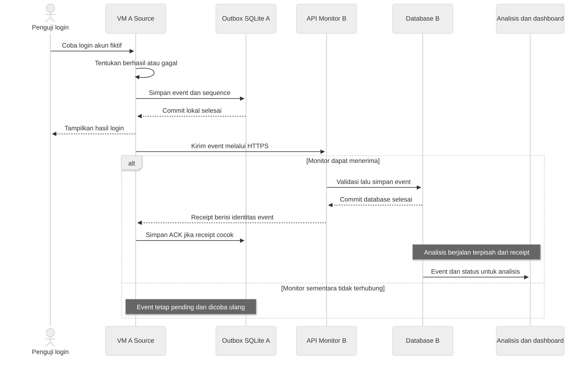

# Memahami proyek sebelum mulai menulis kode

Panduan ini ditujukan untuk Erna dan Arhasya yang baru belajar software engineering. Setelah membacanya, kamu diharapkan dapat menjelaskan apa yang dibangun, mengapa pekerjaan dibagi menjadi dua VM, dan bagaimana pekerjaanmu terhubung dengan pekerjaan anggota lain. Kamu belum perlu menghafal semua field API atau semua perintah Git.

## Produk yang akan kita buat

Bayangkan sebuah aplikasi login untuk latihan. Penguji memakai akun fiktif, lalu mencoba login dengan password benar atau salah. Aplikasi menunjukkan hasil autentikasi seperti aplikasi login biasa. Pada saat yang sama, aplikasi mencatat bahwa percobaan tersebut terjadi.

Catatan satu kejadian itu disebut **event**. Kumpulan catatan kejadian disebut **log**. Pada proyek ini, log dipakai untuk mempelajari pola aktivitas, misalnya banyak percobaan login gagal pada suatu rentang waktu. Hasilnya dapat dilihat operator melalui halaman web yang disebut **dashboard**.

Kita membangun dua bagian. **Source** adalah aplikasi yang menghasilkan event; Erna menulis bagian ini. **Monitor** adalah aplikasi yang menerima dan menganalisis event; Arhasya menulis bagian ini. Dua bagian itu dipasang pada dua mesin virtual agar kita dapat menunjukkan komunikasi dan penanganan gangguan antarmesin.

## Ikuti satu percobaan login

Gambar berikut menunjukkan jalur saat pencatatan lokal berhasil. Jika Monitor tidak dapat dihubungi, pekerjaan pengiriman menunggu di Source. Login tetap diproses oleh Source. Kegagalan pencatatan lokal mempunyai penanganan/counter tersendiri sesuai kontrak; gambar ini belum menggambarkan semua kemungkinan error.

[Sumber Mermaid](../architecture/assets/learning/event-journey.mmd).

Erna perlu menyimpan event di Source lebih dahulu agar event tidak hanya berada di memori program. Penyimpanan itu disebut **outbox**, yaitu antrean pengiriman yang disimpan dalam database lokal. Bila program berhenti atau Monitor sedang mati, event yang sudah berhasil disimpan masih dapat dikirim kemudian.

Komponen pengirim disebut **sender**. Sender membaca outbox, lalu mengirim event ke Monitor. Monitor memeriksa dan menyimpan event sebelum membalas. Balasan penyimpanan ini disebut **receipt**. Receipt berisi identitas event agar Source dapat memastikan jawaban itu memang untuk event yang sedang dikirim.

Setelah receipt cocok, Source menyimpan konfirmasi lokal yang disebut **ACK**, singkatan dari acknowledgment. ACK inilah yang menandai bahwa pengiriman telah dikonfirmasi. Jika koneksi putus sebelum receipt sampai, Source boleh mengirim event yang sama lagi. Monitor harus mengenali duplikat itu agar satu kejadian tidak dihitung dua kali.

Analisis berjalan sesudah data tersedia di Monitor. Receipt tidak perlu menunggu perhitungan model. Pemisahan ini membuat pengiriman log tetap dapat berlangsung ketika analisis membutuhkan waktu lebih lama.

## Apa yang ditulis masing-masing anggota

| Orang | Contoh hasil kerjanya | Cara membuktikan |
| --- | --- | --- |
| Erna | Login menghasilkan event, outbox menyimpannya, sender mengirim dengan retry | Tes login, transaksi, receipt, duplikat dan restart; kemudian uji Source pada VM |
| Arhasya | Penerima menyimpan event, analisis membentuk hasil, dashboard menampilkannya | Tes input valid/invalid, hasil fitur/rules/model dan akses dashboard; kemudian uji Monitor pada VM |
| Integrator | Menetapkan format data bersama, helper, dependency, training offline dan penggabungan hasil | Fixture yang sama dipakai kedua anggota; kedua VM dari commit yang sama lolos pemeriksaan bersama |

Integrator adalah orang yang menjaga bagian bersama dan menyatukan hasil. Tugas ini dipegang pemilik repo/pemimpin tim sampai nama lain ditetapkan. Ketika format event perlu berubah, integrator membantu memastikan Erna dan Arhasya mengubah bagian yang terkait dengan cara yang sama.

## Membaca nomor requirement dan task

**Requirement** adalah kebutuhan yang harus dipenuhi sistem. Sebagai contoh, EP-03 mengatur agar event yang dikirim ulang tetap menghasilkan satu record operasional. **Task** adalah pekerjaan untuk memenuhi kebutuhan itu, misalnya E-04 meminta Erna menulis sender dan tes retry.

Prefix membantu mencari kelompoknya: EP adalah Event Pipeline atau alur event; AA adalah Activity Analysis atau analisis aktivitas; ML adalah Machine Learning; UI adalah antarmuka operator; OP adalah operasi lab. Huruf E pada task menunjukkan pekerjaan Erna, R pekerjaan Arhasya, F fondasi integrator, dan I pekerjaan integrasi bersama. Nomor tersebut adalah rujukan agar diskusi dan bukti tidak tertukar.

Kamu tidak perlu membaca seluruh SRS sebelum mengerjakan satu task. Buka requirement yang dirujuk task tersebut. Panduan tugas menjelaskan langkah kerja, sedangkan **SRS** menjelaskan aturan teknis secara lebih lengkap. **PRD** menjelaskan tujuan dan batas produk. Jika panduan dan SRS berbeda, catat perbedaannya untuk dibahas sebelum melanjutkan bagian yang terdampak.

## Apa arti tes dan hasil yang diharapkan

Tes memberi input tertentu pada kode, lalu membandingkan hasil aktual dengan hasil yang diharapkan. Contohnya: kirim event yang sama dua kali. Hasil yang diharapkan adalah hanya satu record tersimpan. Jika jumlah record menjadi dua, tes gagal meskipun kedua request menghasilkan jawaban HTTP sukses.

**Unit test** memeriksa bagian kecil seperti perhitungan fitur atau pemeriksaan receipt. **Contract test** memeriksa format dan perilaku pertukaran data yang disepakati. **Integration test** memeriksa beberapa komponen yang bekerja bersama. Pengujian kedua VM di jaringan sebenarnya menambah bukti bahwa bagian yang lulus sendiri juga dapat berkomunikasi.

Untuk mulai menguji tanpa menunggu anggota lain, kita memakai **fixture**, yaitu data uji yang isinya sudah ditetapkan. Kita juga dapat memakai **mock**, yaitu komponen pengganti untuk simulasi. Erna dapat memakai receiver uji sebagai pengganti Monitor; Arhasya dapat memakai fixture sebagai pengganti event dari Source. Tulis bahwa pengujian itu memakai simulasi agar hasilnya dipahami dengan benar.

## Urutan belajar dan bekerja

1. Baca [folder kerja dan terminal](workspace.md) agar tahu perbedaan laptop host, guest, SSH, dan clone Git.
2. Buka [panduan Erna](erna.md) atau [panduan Arhasya](arhasya.md). Kerjakan satu task sampai hasil dan tesnya dapat diperiksa.
3. Gunakan [panduan Git dan PR](../../CONTRIBUTING.md) untuk menyerahkan perubahan. Reviewer membaca hasil sebelum menggabungkannya.
4. Ikuti [integrasi](integration.md) setelah kode peran siap. Di sini kedua VM diuji pada satu lingkungan bersama.

## Status yang perlu diketahui sebelum mencoba command

Repository sekarang memuat dokumentasi. Kode aplikasi, helper, dependency lock dan installer belum diterbitkan. Karena itu, panduan coding menjelaskan apa yang harus dibuat dan bagaimana menilainya; command seperti `make setup-source` belum dapat dipakai sampai implementasinya tersedia. Integrator menyiapkan fondasi F-01 sampai F-04, kemudian anggota mulai coding dari versi awal yang sama.

Dokumentasi menggunakan contoh untuk membantu belajar. Angka dalam contoh latihan bukan hasil pengujian proyek. Hasil nyata baru dicatat sesudah command atau tes dijalankan pada commit tertentu.
