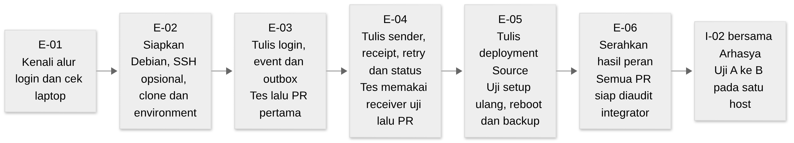

# Panduan Erna menulis dan memasang Source

Erna bertanggung jawab atas aplikasi yang dipakai penguji untuk mencoba login. Selain menampilkan berhasil atau gagal, aplikasi harus menghasilkan catatan kejadian dan mengirimkannya dengan aman ke Monitor. Karena itu pekerjaan Erna mencakup kode login, penyimpanan event lokal, pengiriman, tes, dan pemasangan service di Debian.

Jika baru mulai, baca [dasar proyek](basics.md) dahulu, kemudian [folder kerja dan SSH](workspace.md). Seluruh langkah coding di panduan ini dikerjakan pada clone guest `~/LogLab`. Aplikasi/helper belum diterbitkan di repo; tahap persiapan F-01 sampai F-04 harus menyediakan environment dan kontrak yang dibutuhkan sebelum E-02 dan coding dimulai.

## Gambaran perjalanan Erna

[Sumber Mermaid](../architecture/assets/learning/erna-journey.mmd).

Setiap tahap menghasilkan sesuatu yang dapat ditinjau. E-03 menghasilkan login dan outbox yang dapat diuji sendiri. E-04 menambahkan pengiriman menggunakan receiver uji. E-05 menyiapkan aplikasi sebagai service pada guest. E-06 menyerahkan hasil peran; setelahnya Erna ikut pengujian dua VM pada I-02.

## Hasil akhir yang harus dapat diperlihatkan

Penguji membuka Source dari browser host dan mencoba login akun fiktif. Source menghasilkan event dengan identitas tetap, menyimpannya pada database lokal, lalu sender mengirim event itu ke B. Bila B sementara tidak tersedia, event yang sudah commit tetap menunggu dan dikirim lagi setelah B pulih. Restart guest tidak menghapus pekerjaan yang belum selesai.

Requirement utama adalah [EP-01 sampai EP-07](../requirements/srs/event-pipeline.md) serta bagian [operasi](../requirements/srs/lab-operations.md) yang berkaitan dengan instalasi, keamanan dan pemulihan. EP-04 pada penerima dikerjakan Arhasya; Erna menggunakan aturan yang sama pada sender dan tes receipt.

## File yang menjadi tempat coding

| File atau direktori rencana | Kegunaannya |
| --- | --- |
| `src/loglab/source_app.py` | Form/route login yang diakses melalui HTTP/HTTPS |
| `src/loglab/source_main.py` | Memulai runtime Source dan membaca konfigurasi yang diberikan |
| `src/loglab/source_service.py` | Logika autentikasi dan transaksi outbox/counter/sequence |
| `src/loglab/seed_source_accounts.py` | Menyiapkan akun latihan fiktif secara berulang tanpa duplikasi |
| `src/loglab/sender.py` | Membaca antrean, mengirim, memeriksa receipt, retry dan status sumber |
| `tests/test_source.py`, `tests/test_sender.py` | Bukti otomatis bahwa bagian Source memenuhi skenario yang ditetapkan |
| `deployment/source/`, `config/source.example.*` | Konfigurasi service/firewall dan nilai contoh yang aman |

File ini merupakan target implementasi. Integrator menyiapkan package skeleton dan helper bersama seperti `events.py`, `db.py`, `config.py`, dan `security.py`. Ketika butuh perubahan helper, jelaskan kebutuhan melalui PR bersama agar Arhasya tidak menerima versi yang berbeda. Nama/fungsi helper aktual dibekukan pada F-02/F-03; panduan ini tidak mengarang signature Python sebelum itu selesai.

## E-01 Mengenal alur dan memeriksa laptop

Tujuan awal adalah memastikan Erna tahu apa yang akan dibuktikan. Buka diagram perjalanan event pada dasar proyek. Tulis urutan lima kejadian: hasil login ditentukan, event commit lokal, sender mengirim, B memberi receipt, dan A menyimpan ACK. Jelaskan mengapa event yang belum mendapat receipt tetap berada di antrean.

Di host, catat OS, versi VMware, RAM dan ruang disk tersedia. Profil Source adalah 1 vCPU, RAM 1 GiB dan disk dinamis 20 GiB; host juga membutuhkan resource untuk OS-nya sendiri. Catatan resource dipakai untuk memeriksa apakah instalasi layak, bukan dianggap sebagai bukti kinerja aplikasi.

Hasil E-01 berupa catatan singkat prasyarat dan alur yang akan dibuat. Task selesai setelah integrator dapat melihat resource yang tersedia dan pemahaman Erna tentang urutan event/receipt. Requirement terkait: EP-01–EP-03 dan OP-01.

## E-02 Menyiapkan guest untuk coding

Tahap ini menunggu baseline F-04. Integrator memberikan ISO/hash, versi dependency, helper, fixture, dan command bootstrap. Pasang Debian sesuai acuan pada VM `LogLab-Source-Erna`, siapkan akun `loglab`, jaringan, serta SSH jika ingin mengerjakan terminal dari host.

Ikuti [workspace](workspace.md) untuk clone ke `~/LogLab`. Buat branch task dari baseline yang diberikan, kemudian jalankan bootstrap environment. **Environment** di sini berarti Python beserta library yang diperlukan agar kode kedua anggota dijalankan pada versi yang sama.

Periksa empat hasil: guest memakai Debian yang ditetapkan, repo remote benar, branch kerja benar, dan tes fondasi dari integrator dapat dijalankan. Simpan output yang relevan tanpa credential. Jika command bootstrap belum tersedia, laporkan sebagai blocked F-03/F-04; tugas coding berikutnya belum dapat dinilai dengan environment yang sesuai.

## E-03 Menulis login dan outbox

Tujuannya adalah merekam hasil login sebelum pekerjaan pengiriman dimulai. Fokus pada EP-01, EP-02 dan EP-05. Mulai dari branch `feat/erna-login-outbox`; kerjakan aplikasi/service Source, seed akun dan `tests/test_source.py`.

### Langkah pengerjaan

1. Gunakan helper security untuk menyimpan hash password akun fiktif. **Hash password** adalah nilai turunan untuk pemeriksaan password, sehingga penyimpanan akun tidak memerlukan password mentah. Fungsi seed hanya menambah akun yang diperlukan dan aman dijalankan ulang.
2. Tulis route login yang menerima input form, memeriksa akun dan menghasilkan keputusan berhasil/gagal. Pisahkan keputusan autentikasi dari detail pengiriman ke Monitor agar login tidak menunggu jaringan A–B.
3. Gunakan pembentuk event bersama untuk membuat field sesuai schema. Field adalah nama data seperti `event_id` atau `occurred_at`; schema menetapkan tipe, format dan batas yang diizinkan. Akun/client dalam event memakai pseudonim sesuai kontrak, bukan identitas nyata.
4. Simpan event, sequence dan counter terkait pada transaksi lokal. **Transaksi** adalah kelompok perubahan database yang harus berhasil bersama atau dibatalkan bersama. Event dianggap diterima lokal setelah commit berhasil. Ikuti penanganan kegagalan enqueue pada SRS tanpa mengubah keputusan autentikasi hanya karena Monitor sedang mati.
5. Tulis tes skenario di bawah, lalu buka PR pertama. Reviewer harus dapat melihat pemisahan input form, keputusan auth dan transaksi pencatatan.

### Contoh yang diperiksa

Contoh ini adalah rencana pengujian, bukan hasil run. Penguji melakukan satu login benar dan satu login salah dengan akun fiktif. Jika kedua transaksi pencatatan berhasil, outbox memiliki dua event dengan ID berbeda, jenis `login.success`/`login.failure` yang sesuai, dan sequence yang naik. Kedua event tidak memuat password.

| Case | Cara memeriksa | Hasil yang diharapkan |
| --- | --- | --- |
| E3-01 | Password benar pada akun fiktif | Auth berhasil dan satu event success tercatat |
| E3-02 | Password salah | Auth gagal dan satu event failure tercatat |
| E3-03 | Simulasikan transaksi outbox gagal | Tidak ada event setengah jadi atau sequence yang dianggap commit; counter/penanganan gagal sesuai kontrak |
| E3-04 | Baca ulang DB setelah proses Source dihentikan dan dimulai | Event yang telah commit tetap ada |
| E3-05 | Jalankan seed akun dua kali | Akun tidak terduplikasi dan credential yang sudah ditetapkan tidak tertimpa sembarangan |

Gunakan database sementara pada tes, bukan database aktif yang dipakai demonstrasi. Task selesai ketika hasil auth, isi event, sequence dan durability sesuai tes. **Durability** berarti data yang sudah commit tetap tersedia sesudah proses berhenti. Pengiriman ke B masih dikerjakan pada E-04.

## E-04 Menulis sender dan status sumber

Tujuan tahap ini adalah memindahkan event dari antrean A ke penyimpanan B tanpa menghitung ulang kejadian yang sama. Requirement: EP-03, EP-06, EP-07 dan kesesuaian API EP-04. Mulai dari main yang sudah berisi E-03 melalui branch `feat/erna-sender`. Integrator menyediakan receiver uji dan fixture receipt.

### Memahami receipt sebelum menulis kode

Anggap event di outbox mempunyai ID latihan `evt-1`. Nama ini hanya penyederhanaan penjelasan; event sebenarnya wajib memakai UUID sesuai schema. Bila receiver menjawab receipt untuk event lain, misalnya `evt-2`, sender tidak boleh menyelesaikan event `evt-1`. Di kode nyata, periksa `source_id`, `event_id` dan `event_digest`, bukan hanya status HTTP.

**Digest** adalah sidik jari isi event. Pemeriksaan digest membantu memastikan receipt merujuk isi yang sama. Helper bersama harus menghitung digest dengan cara yang sama pada Source dan Monitor.

### Langkah pengerjaan

1. Pilih event pending dari outbox. Pending berarti telah tersimpan tetapi belum mendapat ACK lokal. Pastikan hanya satu sender aktif untuk database yang sama.
2. Kirim event melalui endpoint dan TLS/auth sesuai kontrak. Baca CA dan token dari konfigurasi privat; identitas event serta payload tetap sama pada setiap retry.
3. Jika receipt cocok, commit perubahan status lokal menjadi ACKNOWLEDGED. Jika timeout atau response sementara terjadi, simpan pekerjaan untuk retry sesuai backoff/timeout SRS.
4. Untuk response permanen seperti konflik/invalid, tahan event beserta alasan aman untuk diperiksa. Menahan event berbeda dari menghapusnya.
5. Kirim status sumber secara periodik. **Watermark ACK kontigu** berarti sequence tertinggi yang seluruh sequence sebelumnya sudah ACK. Jika sequence 1 dan 3 ACK tetapi 2 belum, watermark belum boleh meloncat ke 3.

### Pemeriksaan dan hasil

| Case | Kondisi | Hasil yang diharapkan |
| --- | --- | --- |
| E4-01 | Receipt dengan source/event/digest cocok | ACK disimpan pada Source |
| E4-02 | Receipt salah satu fieldnya tidak cocok | Event tidak dianggap selesai |
| E4-03 | Receiver timeout, 429 atau 5xx | Retry mengikuti aturan; ID/payload tidak berubah |
| E4-04 | Event dikirim ulang setelah receipt pertama hilang | Receiver mengembalikan duplicate sah; tidak ada record kedua |
| E4-05 | Proses berhenti sebelum/sesudah ACK | Pekerjaan dapat dipulihkan dari database sesuai titik commit |
| E4-06 | Ada lubang ACK sequence | Status mengirim watermark kontigu yang benar |

Tes memakai receiver uji, sehingga tulis dengan jelas bahwa B asli belum terlibat. Kirim PR sesudah tes sender dapat ditinjau. E-04 selesai ketika pengiriman, receipt, retry, restart dan status sumber memenuhi kontrak pada skenario tersebut.

## E-05 Memasang Source sebagai service

Ketika kode sudah lulus tes, aplikasi perlu dapat berjalan tanpa bergantung pada terminal coding. Program latar belakang yang dikelola OS disebut **service**. Debian menggunakan systemd untuk menyalakan, menghentikan, dan memulai service saat boot.

Erna membuat unit service dan aturan jaringan Source di `deployment/source/`, serta template nilai contoh pada `config/`. Integrator mengurus wrapper Makefile dan helper umum; koordinasikan target `make setup-source` agar root Makefile tidak diubah berbeda pada dua branch. Target itu belum tersedia sampai task ini diimplementasikan dan diperiksa.

Jalankan setup pada environment uji yang sesuai. Buka Source dari browser host melalui HTTPS dengan CA lab yang dipercaya. Ulangi setup untuk memeriksa bahwa akun/service tidak ganda dan secret/data tidak tertimpa. Kemudian restart dan reboot guest; catat apakah IP, service serta data tetap benar.

Backup database harus memakai prosedur konsisten yang diberikan helper, kemudian dipulihkan pada lokasi terisolasi. Database aktif tidak ditimpa untuk latihan. Task ini memenuhi bagian OP-01/OP-02/OP-03/OP-06 yang terkait Source dan selesai setelah prosedur instalasi ulang, startup dan recovery dapat diulang reviewer.

## E-06 Menyerahkan hasil peran

E-06 mengumpulkan hasil Erna **sebelum** uji dua VM. Isinya adalah PR task yang sudah direview, daftar file, case/requirement, commit, command, expected/actual, pass/fail, dan masalah tersisa. Tulis ringkasan aman di `docs/tasks/results/erna.md` saat hasil nyata sudah tersedia; simpan raw evidence privat di luar Git.

Contoh catatan yang berguna: “E4-02 pada commit tertentu, receiver uji memberi digest berbeda, event tetap pending; hasil pass.” Catatan “sender sudah bisa” terlalu umum karena reviewer tidak tahu kondisi yang dibuktikan. Screenshot yang disebut layar VMware harus berasal langsung dari VMware; output SSH adalah bukti terminal.

Sesudah hasil peran diserahkan, integrator melakukan audit I-01. Erna lalu ikut I-02 bersama Arhasya untuk mengirim ke Monitor sebenarnya dan membuktikan backlog/ACK pada satu jaringan. Dengan urutan ini, E-06 tidak bergantung pada I-02 yang belum dimulai.
