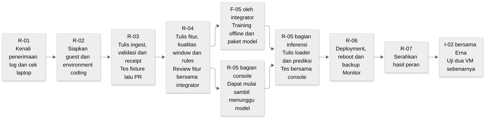

# Tugas Arhasya membuat aplikasi pemantauan

<a href="../../README.md"><kbd>Mulai dari README</kbd></a> <a href="../architecture/BASELINE.md"><kbd>Aturan bersama</kbd></a> <a href="../../README.md#hasil-aplikasi"><kbd>Aplikasi saat selesai</kbd></a> <a href="index.md"><kbd>Daftar tugas</kbd></a> <a href="#hasil-branch"><kbd>Hasil branch saya</kbd></a>

Arhasya bertanggung jawab atas penerima log serta halaman tempat operator memeriksa hasilnya. Kodenya harus menerima event sesuai kontrak, menyimpan data sebelum menjawab Source, mengelompokkan aktivitas, menghitung hasil, dan menampilkannya dengan konteks yang benar.

Beban Monitor lebih luas daripada Source. Karena itu pekerjaan dibagi menjadi ingest, analisis, inferensi, console, lalu deployment. Integrator menyiapkan training offline dan paket model. Arhasya tetap menulis loader serta jalur inferensi runtime, yaitu pemakaian model yang sudah dilatih untuk menghitung prediksi pada input baru.

Baca [dasar proyek](bersama.md#kenali-aplikasi-yang-dibangun) dan [workspace](bersama.md#folder-dan-terminal) sebelum mulai. Kerjakan satu tahap lalu baca SRS yang dirujuk tahap tersebut. Source/helper dan command bootstrap belum diterbitkan; coding dimulai setelah fondasi F-04 siap.

## Pilih bagian

[Hasil repo saat selesai](#hasil-branch) · [Catatan hasil](#catatan-hasil)

1. [Kenali penerimaan log dan cek laptop](#langkah-1)
2. [Siapkan Debian dan folder kerja](#langkah-2)
3. [Terima dan simpan catatan dari Source](#langkah-3)
4. [Hitung aktivitas dan periksa pola login](#langkah-4)
5. [Pakai model dan buat halaman operator](#langkah-5)
6. [Pasang aplikasi agar hidup saat VM menyala](#langkah-6)
7. [Serahkan hasil pekerjaan Monitor](#langkah-7)

## Gambaran perjalanan Arhasya



[Sumber Mermaid](../architecture/assets/learning/arhasya-journey.mmd).

R-03 dapat diuji memakai fixture tanpa menunggu Source Erna. Setelah fitur R-04 diterima, integrator menggunakan fitur yang sama untuk training F-05. Sambil menunggu paket model, Arhasya dapat menulis route console yang tidak bergantung pada prediksi final. Pengujian inferensi akhir menunggu paket dan fixture prediksi tersebut.

<a id="hasil-branch"></a>

## Hasil pekerjaan Arhasya yang harus ada di repo

Ini adalah target setelah kode dan pemasangan Monitor selesai. File aplikasi tersebut belum tersedia hari ini. Branch Arhasya memuat fondasi dari main beserta perubahan Monitor. Bila Source Erna sudah masuk main, file Source juga muncul setelah branch Arhasya disinkronkan. Kehadiran file itu normal pada satu repo bersama.

### Bentuk folder yang diharapkan

```text
LogLab/
├── README.md                          penjelasan proyek dari main
├── Makefile                           target bersama dari penanggung jawab repo
├── pyproject.toml                     aturan package/Python dari main
├── requirements.lock                  versi library dari main
├── src/loglab/
│   ├── __init__.py                     fondasi package dari main
│   ├── events.py                      aturan event bersama dari main
│   ├── db.py                          fungsi database bersama dari main
│   ├── config.py                      pembacaan konfigurasi dari main
│   ├── security.py                    fungsi keamanan bersama dari main
│   ├── backup.py                      fungsi backup bersama dari main
│   ├── monitor_app.py                 API penerima dan halaman operator
│   ├── monitor_main.py                menjalankan aplikasi Monitor
│   ├── analysis.py                    window, kualitas, revisi dan rules
│   ├── features.py                    tujuh fitur, ditinjau bersama untuk training
│   └── model.py                       baca paket model dan hitung prediksi
├── tests/
│   ├── test_monitor_app.py            tes API serta akses dashboard
│   ├── test_analysis.py               tes window, kualitas dan rules
│   ├── test_features.py               tes nilai tujuh fitur
│   ├── test_model.py                  tes paket dan inferensi
│   └── fixtures/                      contoh request, receipt dan prediksi bersama
├── config/monitor.example.env         nama konfigurasi dan nilai contoh aman
├── deployment/monitor/
│   ├── setup.sh                       pemasangan peran Monitor
│   ├── loglab-monitor.service         cara systemd menjalankan Monitor
│   └── monitor.nft                    aturan firewall Monitor
└── docs/tugas/arhasya.md               panduan ini dan catatan hasil nyata Arhasya
```

Pohon ini menampilkan bagian yang relevan untuk Monitor. Dokumen dan file lain dari main tetap ada. Nama skrip/konfigurasi di atas menjadi target penulisan tugas, bukan bukti bahwa installer sekarang sudah tersedia. Integrator menangani helper bersama serta `dataset.py`, `generate_dataset.py`, `training.py`, dan `train_model.py` untuk training offline.

Paket model disediakan integrator beserta hash dan contoh prediksi yang diharapkan. Arhasya memasang paket itu pada lokasi runtime sesuai konfigurasi, lalu menulis loader/inferensi pada `model.py`. Model eksperimen, database aktif, log privat dan secret tidak dimasukkan ke PR. Lokasi runtime serta cara memperoleh paket dicatat pada panduan pemasangan setelah paket tersedia.

### Apa yang harus bekerja saat diperlihatkan

| Hasil yang dituju | Cara reviewer membuktikannya | Bukti yang diserahkan |
| --- | --- | --- |
| Event valid tersimpan dan mendapat receipt | Jalankan R3-01 dengan fixture bersama | Identitas record dan receipt yang cocok |
| Event identik dua kali menjadi satu record | Jalankan R3-02; periksa hitungan dan receipt kedua | Jumlah record tetap satu dan status duplicate sah |
| Input salah/konflik ditolak dengan aman | Jalankan R3-03/R3-04 | Status/alasan sesuai kontrak; record awal tidak tertimpa |
| Perhitungan fitur dan rules benar | Bandingkan contoh manual dan tes batas pada langkah 4 | Nilai fitur, membership window dan alasan rule |
| Model yang valid memberi hasil sesuai fixture; paket rusak/hilang terlihat gagal | Jalankan tes model dari langkah 5 | Hash/version, expected/actual skor/label, serta state gagal yang benar |
| Operator dapat mencari event dan membaca hasil | Buka dashboard dari host, uji sesi/filter/detail | Tes akses dan catatan percobaan reviewer |
| Monitor pulih setelah reboot dan restore terisolasi | Jalankan langkah 6 | Hasil service/IP/data/model dan pemeriksaan restore |

Fixture memungkinkan Arhasya membuktikan bagian Monitor sendiri. Uji dari Source Erna yang sebenarnya tetap dikerjakan kemudian pada dua VM dalam satu host integrasi.

### Isi setiap branch dan PR

Buat beberapa branch pendek. Setiap PR mempunyai hasil yang bisa diperiksa; tidak perlu menunggu seluruh Monitor selesai untuk meminta review. Branch berikutnya dimulai dari main yang sudah memuat PR sebelumnya.

| Branch contoh | Perubahan yang diharapkan pada PR | Syarat sebelum meminta merge |
| --- | --- | --- |
| `feat/arhasya-ingest` | Endpoint penerima/status, startup dasar dan tes API | Validasi, transaksi, receipt dan duplicate lulus R-03 |
| `feat/arhasya-fitur` | `features.py` dan `test_features.py` | Tujuh nilai dan urutannya benar; review integrator selesai |
| `feat/arhasya-analisis` | `analysis.py` dan tes snapshot/kualitas/rules | Perhitungan window, revisi dan state lulus R-04 |
| `feat/arhasya-model` | `model.py` dan tes paket/inferensi | Paket dari integrator tersedia; validasi dan hasil prediksi sesuai fixture pada bagian model R-05 |
| `feat/arhasya-halaman` | Route/halaman operator dan tes aksesnya | Sesi, pencarian, detail dan kondisi data sesuai bagian console R-05 |
| `feat/arhasya-monitor-deployment` | Setup/service/firewall/template Monitor dan startup yang dibutuhkan | Setup ulang, HTTPS, reboot dan recovery lulus R-06 |
| `docs/arhasya-hasil` jika diperlukan | Bagian Catatan hasil pada panduan Arhasya | Hasil nyata ditautkan ke commit dan case yang diperiksa |

Tes fitur boleh direview lebih awal agar integrator mulai training. Uji perilaku model final tetap menunggu paket yang dilatih dari fitur yang disepakati. File helper/dependency/Makefile bersama tidak diubah berbeda pada branch lain tanpa koordinasi.

[Mulai mengerjakan langkah 1](#langkah-1) · [Lihat aturan Monitor](../requirements/srs/index.md) · [Cara kirim PR](../../CONTRIBUTING.md)

<a id="langkah-1"></a>

## 1. Kenali penerimaan log dan cek laptop

Nomor catatan pekerjaan: `R-01`. Gunakan nomor ini ketika menulis PR atau hasil tes.

<a href="bersama.md#kenali-aplikasi-yang-dibangun"><kbd>Pengenalan aplikasi</kbd></a>

Perhatikan perjalanan event pada dasar proyek. Monitor menyimpan event sebelum menjawab receipt. Jika menjawab sukses terlebih dahulu tetapi proses mati sebelum menyimpan, Source mungkin menganggap pekerjaannya selesai padahal data hilang. Hubungan ini menjadi alasan utama urutan validasi → commit → receipt.

Tulis penjelasan singkat urutan itu, lalu catat OS/VMware, RAM dan disk host. Profil Monitor adalah 2 vCPU, RAM 2 GiB, disk dinamis 20 GiB. Task awal selesai ketika resource tercatat dan Arhasya dapat menjelaskan perbedaan “API merespons” dengan “event benar-benar tersimpan”. Requirement terkait: EP-03/EP-04 dan OP-01.

[Kembali ke hasil yang dituju](#hasil-branch) · [Aturan bersama](../architecture/BASELINE.md) · [Lanjut ke langkah 2](#langkah-2)

<a id="langkah-2"></a>

## 2. Siapkan Debian dan folder kerja

Nomor catatan pekerjaan: `R-02`. Gunakan nomor ini ketika menulis PR atau hasil tes.

<a href="bersama.md#folder-dan-terminal"><kbd>Panduan folder dan SSH</kbd></a>

Menunggu baseline F-04. Pasang Debian dari ISO/hash yang sama dengan Erna, gunakan VM `LogLab-Monitor-Arhasya`, akun `loglab`, dan jaringan host-only. SSH direkomendasikan untuk menempelkan perintah dari host, dengan console sebagai alternatif.

Clone ke `~/LogLab`, buat branch task dari baseline yang diberikan, lalu ikuti bootstrap Python/dependency. Periksa OS, remote repo, branch, folder dan tes fondasi. Simpan hasil aman. Jika environment atau fixture belum disediakan, laporkan dependensi agar kode berikutnya tidak ditulis berdasarkan format tebakan.

[Kembali ke hasil yang dituju](#hasil-branch) · [Aturan bersama](../architecture/BASELINE.md) · [Lanjut ke langkah 3](#langkah-3)

<a id="langkah-3"></a>

## 3. Terima dan simpan catatan dari Source

Nomor catatan pekerjaan: `R-03`. Gunakan nomor ini ketika menulis PR atau hasil tes.

<a href="../requirements/srs/event-pipeline.md"><kbd>Aturan penerimaan catatan</kbd></a>

**Ingest** berarti proses menerima data masuk. **API** adalah cara aplikasi bertukar request dan response dengan format yang disepakati. Pada tahap ini, Arhasya membuat endpoint penerima event dan status sumber sesuai [EP-03/EP-04/EP-05/EP-07](../requirements/srs/event-pipeline.md).

Mulai di branch `feat/arhasya-ingest`. Kerjakan endpoint pada aplikasi Monitor, pemanggilan helper DB dan tes ingest. Fixture integrator menyediakan event valid, event invalid, digest dan response yang diharapkan.

### Langkah pengerjaan

1. Periksa autentikasi, sumber, ukuran dan bentuk JSON request. JSON adalah format data dengan pasangan nama/nilai; misalnya `schema_version` berisi angka versi. Ikuti batas serta field yang diterima schema bersama.
2. Periksa digest dan identitas event. Event ID menandai satu kejadian; sequence menunjukkan urutan dalam stream Source. Kedua identitas tidak boleh dipakai ulang untuk isi berbeda.
3. Simpan event dan informasi receipt dengan transaksi. Balas setelah commit berhasil. Untuk duplikat identik, kembalikan duplicate sah sesuai kontrak tanpa membuat record tambahan.
4. Untuk konflik, pertahankan record awal dan kirim error sesuai kontrak. Untuk status sumber, simpan metadata waktu/watermark; status bukan event login baru.
5. Tes sebelum menambahkan analisis. Fokus R-03 adalah perilaku penerimaan, sehingga kegagalan analisis belum boleh menghambat receipt event yang sudah tersimpan.

### Contoh dan syarat selesai

Kirim fixture event yang sama dua kali. Hasil yang diharapkan adalah satu record event pada B. Receipt kedua menunjukkan duplikat untuk identitas dan digest yang sama. Berikutnya, ubah isi tetapi gunakan ID awal; permintaan itu harus ditolak sebagai konflik dan record awal tetap utuh.

| Case | Input | Yang harus diperiksa |
| --- | --- | --- |
| R3-01 | Event valid | Record tersimpan dan receipt cocok |
| R3-02 | Event identik dikirim ulang | Satu record, receipt duplicate sah |
| R3-03 | ID/sequence konflik | Error sesuai kontrak; data awal tidak berubah |
| R3-04 | Token salah, schema/digest invalid atau payload berlebih | Ditolak pada kategori yang benar, tanpa secret pada log |
| R3-05 | Status sumber valid/invalid | Field dan watermark divalidasi; tidak menambah event login |

Kirim PR ingest setelah case tersebut dapat diulang. Pengujian ini menggunakan fixture, sehingga belum menjadi bukti koneksi dari Source sebenarnya.

[Kembali ke hasil yang dituju](#hasil-branch) · [Aturan bersama](../architecture/BASELINE.md) · [Lanjut ke langkah 4](#langkah-4)

<a id="langkah-4"></a>

## 4. Hitung aktivitas dan periksa pola login

Nomor catatan pekerjaan: `R-04`. Gunakan nomor ini ketika menulis PR atau hasil tes.

<a href="../requirements/srs/activity-analysis.md"><kbd>Aturan perhitungan aktivitas</kbd></a>

Event tunggal memberi tahu bahwa suatu login terjadi. Untuk melihat pola, Monitor mengelompokkan event dalam rentang waktu. Rentang ini disebut **window**. Pada LogLab, window berdurasi 60 detik dengan pengelompokan sesuai source, stream dan client pada [kontrak analisis](../requirements/srs/activity-analysis.md).

**Snapshot** menyimpan kumpulan input dan metadata analisis suatu window. **Revision** adalah versi snapshot ketika membership atau kelas kualitas berubah; revisi lama tetap tersedia. **Fitur** adalah angka yang dihitung dari input, misalnya jumlah login gagal. Model dan rules memakai fitur yang sama agar hasil dapat dibandingkan.

### Mulai dari fitur yang dapat diperiksa manual

Gunakan contoh latihan berikut: satu source/stream/client dan satu akun fiktif memiliki login gagal pada detik 0, 10, 20 dan 30, kemudian login sukses pada detik 40 dalam menit yang sama. Lima event tersebut adalah input latihan, bukan evidence hasil proyek.

| Fitur | Nilai contoh | Alasannya |
| --- | --- | --- |
| `event_count` | 5 | Ada lima event unik |
| `failure_count` | 4 | Empat event login gagal |
| `success_count` | 1 | Satu login berhasil |
| `failure_ratio` | 0.8 | 4 dibagi 5 |
| `distinct_accounts` | 1 | Semua event memakai akun pseudonim yang sama |
| `max_consecutive_failures` | 4 | Empat gagal berurutan sebelum sukses |
| `active_span_seconds` | 40 | Event terakhir dikurangi waktu event pertama |

Tulis tes yang membandingkan ekstraktor terhadap nilai tersebut. Tambahkan event di batas menit untuk membuktikan bahwa waktu tepat pada akhir window masuk window berikutnya. Urutan tujuh fitur harus sama dengan kontrak; jangan mengurutkan kolom sendiri karena model membaca posisi yang telah ditetapkan.

### Lanjutkan ke kualitas dan rules

Kumpulan data belum selalu lengkap ketika window waktunya lewat. Source mungkin masih mengirim backlog. Monitor membutuhkan heartbeat, watermark dan bukti kelengkapan sesuai SRS sebelum menetapkan **READY**, yaitu input layak dianalisis.

Tulis membership/urutan, penutupan window, kualitas dan revisi. Tes window terbuka, data kosong, heartbeat usang, sequence hilang, clock offset dan event terlambat. Hasil tidak layak harus mempunyai alasan yang terlihat. Perubahan data/kualitas membuat revisi baru sesuai kontrak, bukan menghapus riwayat lama.

Setelah itu implementasikan rules. Rule adalah kondisi yang ditetapkan manusia, misalnya hitungan gagal mencapai ambang. Tes ambang 9/10 kegagalan dan 4/5 akun mengikuti aturan `REPEATED_FAILURES` dan `ACCOUNT_SWEEP`. Satu rule menyimpan alasan, versi, hitungan dan event pendukung.

Bagi R-04 menjadi PR fitur, kemudian PR snapshot/kualitas/rules agar review lebih mudah. Requirement AA-01–AA-05 selesai ketika fitur benar, input tidak lengkap ditangani jelas, revisi dapat ditelusuri, dan tes batas lulus. Integrator wajib meninjau ekstraktor sebelum memakainya untuk training F-05.

[Kembali ke hasil yang dituju](#hasil-branch) · [Aturan bersama](../architecture/BASELINE.md) · [Lanjut ke langkah 5](#langkah-5)

<a id="langkah-5"></a>

## 5. Pakai model dan buat halaman operator

Nomor catatan pekerjaan: `R-05`. Gunakan nomor ini ketika menulis PR atau hasil tes.

<a href="../requirements/srs/ml-classifier.md"><kbd>Aturan model</kbd></a> <a href="../requirements/srs/operator-console.md"><kbd>Aturan halaman operator</kbd></a>

Training membentuk parameter model dari dataset; integrator mengerjakannya pada F-05. Inferensi memakai parameter yang sudah dibentuk untuk menghitung prediksi pada fitur baru; bagian ini ditulis Arhasya. Model bukan pengganti pemeriksaan kelengkapan data: snapshot yang belum READY belum boleh diberi label normal/suspicious.

### Bagian inferensi

Di `model.py`, tulis loader paket numerik dan pemeriksaan checksum, schema, urutan fitur serta angka. **Checksum model** membantu mendeteksi file berubah atau korup. Integrator memberikan paket, hash dan contoh prediksi yang diharapkan agar hasil runtime dapat dibandingkan dengan hasil training.

Tes paket valid, hash salah, schema tidak cocok, angka invalid dan paket hilang. Untuk input valid, bandingkan skor/label dengan fixture integrator dalam toleransi yang ditetapkan SRS. Jangan membuat target skor sendiri atau mengubah threshold supaya tes lulus. Threshold adalah batas skor untuk memilih label yang dibekukan bersama paket.

Simpan hasil yang terkait dengan revisi snapshot dan hash model. Bila paket tidak tersedia atau inferensi gagal, hasil mencatat alasan dan label kosong sesuai kontrak. Menghasilkan label normal untuk kegagalan tersebut akan memberi kesan bahwa data telah dianalisis padahal belum.

### Bagian console

Console adalah halaman web operator. Operator perlu login, mencari event, melihat detail, dan mengetahui apakah hasil analisis sudah tersedia atau data belum layak. Mulai bagian ini pada PR terpisah, misalnya `feat/arhasya-console`; route/filter dan data uji dapat dikerjakan sambil menunggu paket model.

Gunakan helper sesi/security untuk login/logout dan proteksi setiap route data. Tes pengguna tanpa sesi tidak dapat membuka data, filter invalid ditolak, pagination dibatasi, dan teks dari input di-escape sebelum dirender. **Escaping** membuat karakter input ditampilkan sebagai teks yang aman pada halaman, bukan dijalankan sebagai kode HTML.

R-05 mencakup ML-05/ML-06 serta UI-01–UI-05. Tahap selesai setelah inferensi sesuai fixture dan operator dapat menelusuri input, rules/model/version serta kualitasnya. Klaim skor dunia nyata tidak dibuat dari dataset latihan sintetis.

[Kembali ke hasil yang dituju](#hasil-branch) · [Aturan bersama](../architecture/BASELINE.md) · [Lanjut ke langkah 6](#langkah-6)

<a id="langkah-6"></a>

## 6. Pasang aplikasi agar hidup saat VM menyala

Nomor catatan pekerjaan: `R-06`. Gunakan nomor ini ketika menulis PR atau hasil tes.

<a href="../requirements/srs/lab-operations.md"><kbd>Aturan pemasangan dan pemulihan</kbd></a>

Sesudah kode lulus tes, buat unit systemd, aturan firewall dan template konfigurasi Monitor pada scope peran. Unit systemd memberi Debian aturan menjalankan aplikasi saat boot. Firewall membatasi koneksi ke layanan sesuai profil lab.

Koordinasikan root Makefile dengan integrator agar `make setup-monitor` memakai helper umum dan file Monitor yang benar. Jalankan setup pada guest uji, ulangi setup, buka dashboard dari host melalui HTTPS, lalu reboot. Periksa kembali IP/service, event yang sudah tersimpan dan identitas paket model.

Jalankan backup konsisten dan restore terisolasi. Pulihkan pada salinan/tujuan uji sehingga data aktif tidak tertimpa. R-06 selesai ketika pemasangan/reboot/recovery dapat diulang dan sesuai bagian OP-01–OP-03/OP-06 terkait Monitor. Catat masalah konfigurasi atau kode yang masih membutuhkan perbaikan.

[Kembali ke hasil yang dituju](#hasil-branch) · [Aturan bersama](../architecture/BASELINE.md) · [Lanjut ke langkah 7](#langkah-7)

<a id="langkah-7"></a>

## 7. Serahkan hasil pekerjaan Monitor

Nomor catatan pekerjaan: `R-07`. Gunakan nomor ini ketika menulis PR atau hasil tes.

<a href="../../CONTRIBUTING.md"><kbd>Cara menyerahkan PR</kbd></a>

R-07 mengumpulkan PR dan bukti Monitor **sebelum** pengujian pasangan. Tulis hasil nyata pada [Catatan hasil](#catatan-hasil): case/requirement, commit, command, expected/actual, pass/fail serta masalah. File itu dibuat ketika hasil sudah ada; raw output privat disimpan di luar Git.

Catatan yang membantu reviewer menyebut kondisi, misalnya “R3-02, fixture sama dikirim dua kali, jumlah record tetap satu dan receipt kedua duplicate.” Catatan “API sudah jalan” belum menunjukkan bahwa duplikasi dicegah.

Sesudah penyerahan hasil peran dan audit I-01, Arhasya ikut I-02 bersama Erna untuk menerima event dari Source sebenarnya. Periksa receipt, outage/backlog, analisis dan console pada satu host/jaringan. Hasil fixture tetap berguna, tetapi belum menggantikan uji dua VM tersebut.

<a id="catatan-hasil"></a>

## Catatan hasil

Bagian ini belum berisi hasil run. Setelah mengerjakan task, isi tabel dengan hasil nyata dan sebutkan commit yang diperiksa. Kata “Belum” di bawah tidak boleh diganti menjadi lulus sebelum tes dijalankan. Simpan output mentah privat di luar Git, lalu tautkan ringkasan aman atau PR yang relevan.

| Langkah atau case | Commit yang diuji | Perintah atau tindakan | Hasil yang diharapkan | Hasil nyata dan bukti aman | Status |
| --- | --- | --- | --- | --- | --- |
| Belum diisi | Belum | Belum | Ikuti case pada langkah terkait | Belum ada hasil | Belum diuji |

Sebelum meminta review akhir, pastikan file pada target repo tersedia, pemeriksaan peran lulus atau keterbatasannya tertulis, dan perubahan bersama telah direview. Daftar PR menunjukkan bagian yang ditulis sendiri dan bagian yang menggunakan ulang sumber lama.

<a href="../../README.md"><kbd>Mulai dari README</kbd></a> <a href="../architecture/BASELINE.md"><kbd>Aturan bersama</kbd></a> <a href="../../README.md#hasil-aplikasi"><kbd>Aplikasi saat selesai</kbd></a> <a href="index.md"><kbd>Daftar tugas</kbd></a> <a href="#hasil-branch"><kbd>Hasil branch saya</kbd></a>


[Lihat cara menguji dua VM bersama](bersama.md#menyatukan-pekerjaan).
