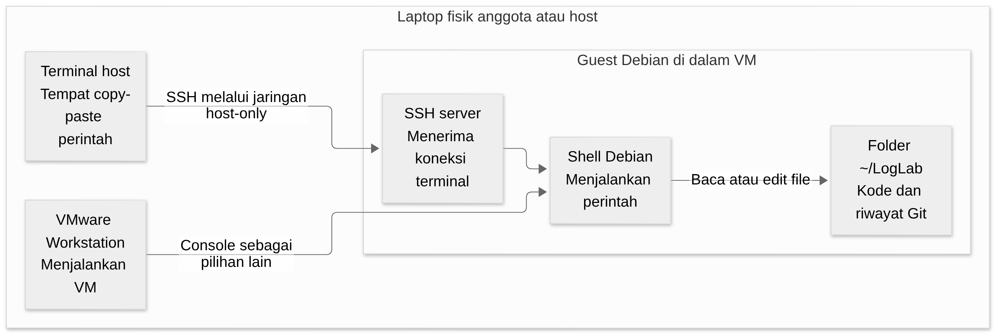
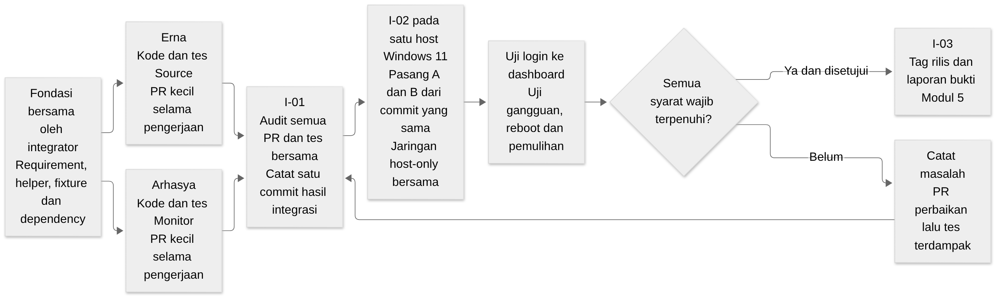
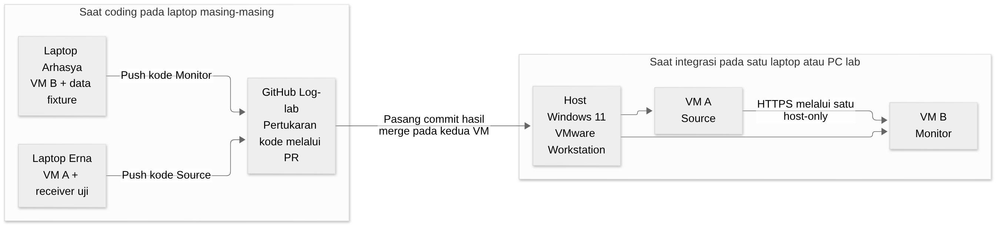

# Panduan bersama untuk tiga orang

<a href="../../README.md"><kbd>Mulai dari README</kbd></a> <a href="index.md"><kbd>Daftar tugas</kbd></a> <a href="erna.md"><kbd>Tugas Erna</kbd></a> <a href="arhasya.md"><kbd>Tugas Arhasya</kbd></a>

Halaman ini menjelaskan pengetahuan dan langkah yang dipakai bersama. Buka bagian yang diperlukan saat mengerjakan tugas; Erna dan Arhasya tetap mengikuti panduan masing-masing sebagai urutan kerja utama.

| Yang ingin kamu cari | Buka bagian |
| --- | --- |
| Aplikasi apa yang kita buat dan mengapa ada dua VM | [Kenali aplikasi](#kenali-aplikasi-yang-dibangun) |
| Perbedaan laptop, VM, SSH, folder proyek dan clone | [Folder dan terminal](#folder-dan-terminal) |
| Cara membuat branch, commit, push dan PR | [Panduan Git di CONTRIBUTING](../../CONTRIBUTING.md) |
| Aturan OS, IP, port, versi dan pembagian file | [Aturan dasar proyek](../architecture/BASELINE.md) |
| Cara menggabungkan hasil lalu menguji kedua VM | [Menyatukan pekerjaan](#menyatukan-pekerjaan) |

## Kenali aplikasi yang dibangun

Panduan ini ditujukan untuk Erna dan Arhasya yang baru belajar software engineering. Setelah membacanya, kamu diharapkan dapat menjelaskan apa yang dibangun, mengapa pekerjaan dibagi menjadi dua VM, dan bagaimana pekerjaanmu terhubung dengan pekerjaan anggota lain. Kamu belum perlu menghafal semua field API atau semua perintah Git.

### Produk yang akan kita buat

Bayangkan sebuah aplikasi login untuk latihan. Penguji memakai akun fiktif, lalu mencoba login dengan password benar atau salah. Aplikasi menunjukkan hasil autentikasi seperti aplikasi login biasa. Pada saat yang sama, aplikasi mencatat bahwa percobaan tersebut terjadi.

Catatan satu kejadian itu disebut **event**. Kumpulan catatan kejadian disebut **log**. Pada proyek ini, log dipakai untuk mempelajari pola aktivitas, misalnya banyak percobaan login gagal pada suatu rentang waktu. Hasilnya dapat dilihat operator melalui halaman web yang disebut **dashboard**.

Kita membangun dua bagian. **Source** adalah aplikasi yang menghasilkan event; Erna menulis bagian ini. **Monitor** adalah aplikasi yang menerima dan menganalisis event; Arhasya menulis bagian ini. Dua bagian itu dipasang pada dua mesin virtual agar kita dapat menunjukkan komunikasi dan penanganan gangguan antarmesin.

### Ikuti satu percobaan login

Gambar berikut menunjukkan jalur saat pencatatan lokal berhasil. Jika Monitor tidak dapat dihubungi, pekerjaan pengiriman menunggu di Source. Login tetap diproses oleh Source. Kegagalan pencatatan lokal mempunyai penanganan/counter tersendiri sesuai kontrak; gambar ini belum menggambarkan semua kemungkinan error.


[Sumber Mermaid](../architecture/assets/learning/event-journey.mmd).

Erna perlu menyimpan event di Source lebih dahulu agar event tidak hanya berada di memori program. Penyimpanan itu disebut **outbox**, yaitu antrean pengiriman yang disimpan dalam database lokal. Bila program berhenti atau Monitor sedang mati, event yang sudah berhasil disimpan masih dapat dikirim kemudian.

Komponen pengirim disebut **sender**. Sender membaca outbox, lalu mengirim event ke Monitor. Monitor memeriksa dan menyimpan event sebelum membalas. Balasan penyimpanan ini disebut **receipt**. Receipt berisi identitas event agar Source dapat memastikan jawaban itu memang untuk event yang sedang dikirim.

Setelah receipt cocok, Source menyimpan konfirmasi lokal yang disebut **ACK**, singkatan dari acknowledgment. ACK inilah yang menandai bahwa pengiriman telah dikonfirmasi. Jika koneksi putus sebelum receipt sampai, Source boleh mengirim event yang sama lagi. Monitor harus mengenali duplikat itu agar satu kejadian tidak dihitung dua kali.

Analisis berjalan sesudah data tersedia di Monitor. Receipt tidak perlu menunggu perhitungan model. Pemisahan ini membuat pengiriman log tetap dapat berlangsung ketika analisis membutuhkan waktu lebih lama.

### Apa yang ditulis masing-masing anggota

| Orang | Contoh hasil kerjanya | Cara membuktikan |
| --- | --- | --- |
| Erna | Login menghasilkan event, outbox menyimpannya, sender mengirim dengan retry | Tes login, transaksi, receipt, duplikat dan restart; kemudian uji Source pada VM |
| Arhasya | Penerima menyimpan event, analisis membentuk hasil, dashboard menampilkannya | Tes input valid/invalid, hasil fitur/rules/model dan akses dashboard; kemudian uji Monitor pada VM |
| Integrator | Menetapkan format data bersama, helper, dependency, training offline dan penggabungan hasil | Fixture yang sama dipakai kedua anggota; kedua VM dari commit yang sama lolos pemeriksaan bersama |

Integrator adalah orang yang menjaga bagian bersama dan menyatukan hasil. Tugas ini dipegang pemilik repo/pemimpin tim sampai nama lain ditetapkan. Ketika format event perlu berubah, integrator membantu memastikan Erna dan Arhasya mengubah bagian yang terkait dengan cara yang sama.

### Membaca nomor requirement dan task

**Requirement** adalah kebutuhan yang harus dipenuhi sistem. Sebagai contoh, EP-03 mengatur agar event yang dikirim ulang tetap menghasilkan satu record operasional. **Task** adalah pekerjaan untuk memenuhi kebutuhan itu, misalnya E-04 meminta Erna menulis sender dan tes retry.

Prefix membantu mencari kelompoknya: EP adalah Event Pipeline atau alur event; AA adalah Activity Analysis atau analisis aktivitas; ML adalah Machine Learning; UI adalah antarmuka operator; OP adalah operasi lab. Huruf E pada task menunjukkan pekerjaan Erna, R pekerjaan Arhasya, F fondasi integrator, dan I pekerjaan integrasi bersama. Nomor tersebut adalah rujukan agar diskusi dan bukti tidak tertukar.

Kamu tidak perlu membaca seluruh SRS sebelum mengerjakan satu task. Buka requirement yang dirujuk task tersebut. Panduan tugas menjelaskan langkah kerja, sedangkan **SRS** menjelaskan aturan teknis secara lebih lengkap. **PRD** menjelaskan tujuan dan batas produk. Jika panduan dan SRS berbeda, catat perbedaannya untuk dibahas sebelum melanjutkan bagian yang terdampak.

### Apa arti tes dan hasil yang diharapkan

Tes memberi input tertentu pada kode, lalu membandingkan hasil aktual dengan hasil yang diharapkan. Contohnya: kirim event yang sama dua kali. Hasil yang diharapkan adalah hanya satu record tersimpan. Jika jumlah record menjadi dua, tes gagal meskipun kedua request menghasilkan jawaban HTTP sukses.

**Unit test** memeriksa bagian kecil seperti perhitungan fitur atau pemeriksaan receipt. **Contract test** memeriksa format dan perilaku pertukaran data yang disepakati. **Integration test** memeriksa beberapa komponen yang bekerja bersama. Pengujian kedua VM di jaringan sebenarnya menambah bukti bahwa bagian yang lulus sendiri juga dapat berkomunikasi.

Untuk mulai menguji tanpa menunggu anggota lain, kita memakai **fixture**, yaitu data uji yang isinya sudah ditetapkan. Kita juga dapat memakai **mock**, yaitu komponen pengganti untuk simulasi. Erna dapat memakai receiver uji sebagai pengganti Monitor; Arhasya dapat memakai fixture sebagai pengganti event dari Source. Tulis bahwa pengujian itu memakai simulasi agar hasilnya dipahami dengan benar.

### Urutan belajar dan bekerja

1. Baca [folder kerja dan terminal](bersama.md#folder-dan-terminal) agar tahu perbedaan laptop host, guest, SSH, dan clone Git.
2. Buka [panduan Erna](erna.md) atau [panduan Arhasya](arhasya.md). Kerjakan satu task sampai hasil dan tesnya dapat diperiksa.
3. Gunakan [panduan Git dan PR](../../CONTRIBUTING.md) untuk menyerahkan perubahan. Reviewer membaca hasil sebelum menggabungkannya.
4. Ikuti [integrasi](bersama.md#menyatukan-pekerjaan) setelah kode peran siap. Di sini kedua VM diuji pada satu lingkungan bersama.

### Status yang perlu diketahui sebelum mencoba command

Repository sekarang memuat dokumentasi. Kode aplikasi, helper, dependency lock dan installer belum diterbitkan. Karena itu, panduan coding menjelaskan apa yang harus dibuat dan bagaimana menilainya; command seperti `make setup-source` belum dapat dipakai sampai implementasinya tersedia. Integrator menyiapkan fondasi F-01 sampai F-04, kemudian anggota mulai coding dari versi awal yang sama.

Dokumentasi menggunakan contoh untuk membantu belajar. Angka dalam contoh latihan bukan hasil pengujian proyek. Hasil nyata baru dicatat sesudah command atau tes dijalankan pada commit tertentu.

## Folder dan terminal

Kamu akan memakai laptop, VMware, Debian, terminal, dan GitHub. Masing-masing mempunyai fungsi berbeda. Memahami perbedaan ini membantu menghindari kesalahan seperti menjalankan perintah Debian di PowerShell atau mencari file Python di folder disk VMware.

### Laptop host dan Debian guest

**Host** adalah laptop fisik yang kamu gunakan. VMware Workstation adalah aplikasi pada laptop itu. **Virtual machine**, disingkat VM, adalah komputer virtual yang dijalankan VMware. Sistem operasi di dalam VM disebut **guest**. Pada proyek ini, guest yang dipakai adalah Debian.

Di host, kamu membuka VMware dan browser. Di guest, kamu memasang Python, menulis kode, menjalankan tes, dan menjalankan aplikasi LogLab. Kedua lingkungan mempunyai filesystem sendiri. File yang dibuat di Debian tidak otomatis muncul sebagai file terpisah di folder Documents Windows.



[Sumber Mermaid](../architecture/assets/learning/host-ssh.mmd).

### Mengapa memakai SSH

SSH membuka sesi terminal ke guest dari terminal host. Sesudah tersambung, perintah yang kamu ketik dijalankan di Debian. Ini memungkinkan kamu menyalin perintah dari panduan lalu menempelkannya di PowerShell/terminal host tanpa bergantung pada clipboard console VMware.

Penggunaan SSH direkomendasikan pemilik proyek untuk kenyamanan copy-paste. Kamu tetap boleh memakai terminal melalui console VMware. Jika SSH bermasalah, console berguna untuk memperbaiki jaringan atau service SSH pada guest.

SSH host-ke-guest berbeda dari autentikasi GitHub. Berhasil masuk Debian lewat SSH belum otomatis memberi izin push ke GitHub. Izin repo diberikan ke akun GitHub masing-masing anggota.

### Folder VMware dan folder proyek

Folder VM di host menyimpan file seperti `.vmx` untuk konfigurasi VM dan `.vmdk` untuk disk virtual. VMware menggunakan file tersebut untuk menjalankan guest. Kamu tidak menulis source Python di folder itu.

Folder proyek adalah hasil **clone** Git di dalam guest. Kita memakai `~/LogLab`. Simbol `~` berarti home akun yang sedang login. Jika akun guest bernama `loglab`, `~/LogLab` sama dengan `/home/loglab/LogLab`. Di folder inilah ada `src/`, `tests/`, `docs/`, dan riwayat `.git/`.

| Yang perlu dibedakan | Erna | Arhasya |
| --- | --- | --- |
| Nama VM pada VMware | `LogLab-Source-Erna` | `LogLab-Monitor-Arhasya` |
| Peran aplikasi | Source atau VM A | Monitor atau VM B |
| Akun Debian yang direncanakan | `loglab` | `loglab` |
| Clone di dalam guest | `~/LogLab` | `~/LogLab` |
| Branch task pertama | `feat/erna-login-outbox` | `feat/arhasya-ingest` |
| IP pada profil integrasi | `172.16.202.21` | `172.16.202.22` |

Nama clone boleh sama karena kedua folder berada pada guest berbeda. Nama branch berbeda untuk menunjukkan pekerjaan yang akan diperiksa. Membuat branch tidak membuat VM atau folder baru.

### Persiapan yang diberikan integrator

Sebelum task coding dimulai, integrator harus memberikan ISO Debian beserta checksum, versi Python/dependency, cara bootstrap environment, commit awal, dan fixture uji. **Checksum SHA-256** adalah sidik jari file untuk memeriksa bahwa ISO yang digunakan sama dengan ISO acuan.

Commit awal yang disepakati disebut **baseline**. Commit itu harus dicatat sebagai SHA lengkap atau tag yang dapat diperiksa. Kedua anggota mulai dari baseline yang sama agar struktur dan helper sesuai. Saat ini baseline pengembangan tersebut belum dilepas; membaca dokumentasi dan mencatat resource laptop dapat dilakukan lebih dahulu.

### Memasang SSH setelah guest dan jaringan siap

Bagian ini dijalankan setelah Debian terpasang, akun tersedia, dan guest memiliki jaringan. Command berikut adalah persiapan alat umum; command ini tidak memasang aplikasi LogLab.

Di **terminal guest Debian**, jalankan:

```bash
sudo apt update
sudo apt install openssh-server git make
sudo systemctl enable --now ssh
ip -br address
```

`apt update` memperbarui daftar paket. Perintah berikutnya memasang server SSH, Git dan Make. `systemctl` mengaktifkan layanan SSH sekarang serta saat guest boot. `ip -br address` menampilkan alamat antarmuka jaringan.

Hasil yang dicari adalah alamat guest pada adapter host-only. `127.0.0.1` adalah alamat mesin itu sendiri dan tidak dipakai host untuk menyambung ke guest. IP `.21` dan `.22` pada panduan merupakan alamat rencana; gunakan setelah profil tersebut benar-benar dikonfigurasi. Cara memasang alamat statis dan memilih VMnet akan difinalkan bersama baseline, karena nama adapter pada setiap mesin dapat berbeda.

Di console guest, periksa fingerprint server SSH:

```bash
sudo ssh-keygen -lf /etc/ssh/ssh_host_ed25519_key.pub
```

Sekarang buka **PowerShell atau terminal host**. Untuk contoh Erna yang sudah mempunyai IP `.21`, jalankan:

```powershell
ssh loglab@172.16.202.21
```

Arhasya menggunakan `.22`. Pada koneksi pertama, SSH meminta pemeriksaan fingerprint. Cocokkan dengan fingerprint dari console guest. Jika sama, terima lalu login menggunakan metode autentikasi yang sudah disiapkan. Password dimasukkan secara interaktif bila login password diizinkan; konfigurasi yang hanya menerima public key memerlukan pemasangan key terlebih dahulu.

Sesudah tersambung, jalankan dua command berikut **di sesi SSH**:

```bash
hostname
pwd
```

`hostname` menunjukkan nama guest. `pwd` menunjukkan folder tempat terminal berada. Kedua hasil itu membantu memastikan bahwa command berikutnya dijalankan pada mesin yang benar. `exit` keluar dari sesi SSH menuju host; guest tetap berjalan.

Jika muncul `Permission denied (publickey)`, akses kembali melalui console lalu ikuti pemasangan public key yang ditentukan pada baseline. Jangan menyalin private key ke anggota lain. Jika koneksi timeout atau ditolak, periksa IP, adapter host-only, service SSH dan firewall dari console.

### Clone repo di Debian

Setelah Git tersedia, jalankan di **guest**, baik melalui SSH maupun console:

```bash
cd ~
git clone https://github.com/sedam-or/Log-lab.git LogLab
cd ~/LogLab
git remote -v
git status --short --branch
```

Command clone mengunduh repo dan membuat folder `LogLab`. Nama di GitHub adalah `Log-lab`, tetapi argumen terakhir memilih nama folder lokal `LogLab`. `git remote -v` harus menunjuk repo `sedam-or/Log-lab`. Status Git menunjukkan branch serta perubahan lokal.

Bila `~/LogLab` sudah ada, periksa isinya dan remote lebih dahulu. Gunakan clone yang benar, bukan menimpa atau menghapus folder tanpa pemeriksaan. Pekerjaan utama dilakukan pada satu clone guest ini. Jika kamu juga meng-clone di host, kedua clone merupakan salinan berbeda; perubahan tidak tersinkron otomatis.

### Cara membaca path file

Path seperti `src/loglab/source_app.py` dihitung dari root repo. Setelah `cd ~/LogLab`, path tersebut berarti `/home/loglab/LogLab/src/loglab/source_app.py`. Path `docs/tugas/erna.md` menunjuk panduan Erna pada clone yang sama.

Saat kode sudah tersedia, kamu dapat membuka file menggunakan editor di guest atau editor host yang mengakses guest. Pilih cara yang kamu pahami dan pastikan editor benar-benar menyimpan pada clone guest. Jika ingin memeriksa perubahan tersimpan, gunakan `git diff` dari `~/LogLab`.

### Membuat branch dan memulai task

Integrator akan memberikan SHA baseline pada F-04. Contoh berikut menjelaskan bentuk command, sehingga `SHA_BASELINE` wajib diganti sebelum dijalankan:

```text
git switch -c feat/erna-login-outbox SHA_BASELINE
```

Erna membuat branch sesuai tasknya; Arhasya memakai `feat/arhasya-ingest`. Setelah task pertama selesai dan masuk main, task berikutnya dimulai dari main terbaru melalui branch baru. Langkah commit, push, PR dan sinkronisasi dijelaskan pelan-pelan pada [panduan kontribusi](../../CONTRIBUTING.md).

### Jika task berhenti karena masalah

Tuliskan task ID, mesin tempat command dijalankan, folder kerja, command, hasil yang diharapkan dan pesan aktual. Contoh: “E-02, guest Source, `~/LogLab`, bootstrap gagal karena dependency belum diterbitkan.” Dengan konteks ini, integrator dapat membedakan masalah kode, paket, jaringan, atau panduan.

Jika yang belum tersedia adalah fondasi F-03/F-04, catat sebagai **blocked**, yaitu pekerjaan belum dapat dilanjutkan karena membutuhkan hasil pekerjaan lain. Jika kode sudah dapat dijalankan tetapi perilakunya salah, catat sebagai **fail**, lalu perbaiki dan tes kembali. Status **pass** hanya dipakai setelah syarat pemeriksaan terpenuhi.

## Menyatukan pekerjaan

Integrator bertanggung jawab agar Source Erna dan Monitor Arhasya memakai aturan yang sama. Tanggung jawab ini dimulai sebelum coding paralel, lalu berlanjut ketika PR masuk dan kedua VM diuji bersama. Nama penanggung jawab integrasi belum diisi; sementara peran tersebut mengikuti pemilik repo/pemimpin tim.

Ada dua hasil yang perlu dibedakan saat merencanakan pekerjaan. **Penggabungan kode** menyatukan perubahan file ke main dan memeriksa tesnya. **Uji aplikasi yang berjalan** menjalankan dua layanan dari kode tersebut pada jaringan yang sama, lalu membuktikan komunikasi sebenarnya. Keduanya diperlukan karena Git dapat menggabungkan file meskipun URL, token, format event atau perilaku kedua layanan belum cocok.



[Sumber Mermaid](../architecture/assets/learning/integration-journey.mmd).

### Tahap pertama menyiapkan bahan kerja bersama

Erna dan Arhasya menulis kode aplikasi. Mereka membutuhkan batas yang jelas supaya tidak harus menebak format event, menulis helper security berbeda, atau memasang dependency yang tidak kompatibel. Integrator menyediakan fondasi F-01 sampai F-04 sebelum environment coding anggota dianggap siap.

#### F-01 Menetapkan kebutuhan yang dipakai

Review [PRD](../requirements/PRD.md), [SRS per bagian](../requirements/srs/index.md), baseline dan diagram. PRD menjelaskan tujuan/scope, sedangkan SRS menjelaskan aturan teknis serta pemeriksaannya. Pastikan target Windows 11, Debian dan peran kedua VM konsisten. Catat usulan lama yang belum diterima agar anggota tidak menganggapnya requirement aktif.

Hasil F-01 adalah versi kebutuhan yang dapat dirujuk Erna/Arhasya, beserta status review yang nyata. Tugas membaca resource laptop E-01/R-01 dapat berlangsung sambil review ini berjalan. Kode peran belum ditandai lulus hanya karena kebutuhan sudah tertulis.

#### F-02 Membekukan format dan interface bersama

Tentukan ISO Debian beserta SHA-256, versi Python/dependency dan helper yang akan tersedia. Tetapkan field event/receipt/status, metode digest dan operasi database/security/config yang diperlukan kedua peran. Jelaskan fungsi dan cara pakai helper; anggota perlu mengetahui input, output serta error yang mungkin terjadi.

Buat fixture event valid/invalid, duplikat, konflik, receipt cocok/tidak cocok dan status sumber. Fixture menjadi contoh yang dapat dijalankan, sehingga Erna dan Arhasya mempunyai jawaban yang sama untuk kasus yang sama. Contohnya, duplikat event identik harus dipahami sebagai satu kejadian oleh kedua sisi.

Tetapkan feature schema serta rubrik training. Paket model final menunggu ekstraktor R-04; jangan membekukan model berdasarkan ekstraktor lain yang belum disepakati. Hasil F-02 berupa kontrak, daftar input bersama, versi lingkungan, dan pembagian file yang bisa diperiksa anggota.

#### F-03 Menyiapkan environment dan alat uji dasar

Siapkan skeleton package, dependency lock, runner tes dan helper bersama `events.py`, `config.py`, `db.py`, `security.py`, serta `backup.py` sesuai kontrak yang ditetapkan. **Skeleton** berarti struktur awal yang menyediakan tempat dan interface untuk menambahkan kode, belum aplikasi peran yang selesai.

Sediakan bootstrap environment, receiver uji untuk Erna dan fixture pengirim untuk Arhasya. Dokumentasikan command beserta expected output yang sudah dicoba pada Debian target. Root Makefile mengoordinasikan pemanggilan helper/target peran; implementasi deployment Source/Monitor diselesaikan pada E-05/R-06.

Bila menggunakan ulang kode lama, periksa dependency/path dan jelaskan asalnya. Anggota tidak diminta mengklaim kode lama yang disalin penuh sebagai implementasi yang ditulis sendiri. F-03 selesai ketika environment dasar dan tes helper dapat dijalankan ulang; pengujian aplikasi penuh menunggu kode anggota.

#### F-04 Membagikan baseline pengembangan

Catat SHA commit yang berisi fondasi, cara bootstrap, ISO/hash, contoh command yang sudah terisi, dan cara memperoleh konfigurasi privat. Periksa bahwa akun GitHub anggota dapat mengakses repo dan menyerahkan perubahan. Pengaturan review/proteksi main diperiksa pada GitHub; aturan yang ditulis pada dokumen tidak otomatis mengaktifkan fitur tersebut.

Beri Erna dan Arhasya sumber panduan dengan versi yang sama. Jika mengekspor PDF, gunakan Markdown yang sama dan pastikan gambar terbaca. Baseline pengembangan ini cukup untuk mulai menulis kode; installer aplikasi yang lengkap tetap diselesaikan bersama kode peran.

### Tahap kedua coding paralel dan review bertahap

Erna mengerjakan login/outbox, sender, lalu deployment. Arhasya mengerjakan ingest, fitur/analisis, inferensi/console, lalu deployment. Setiap bagian mempunyai PR kecil, tes dan reviewer. PR tidak ditahan sampai seluruh task anggota selesai.

Urutan bertahap itu diperlukan untuk dependency model. PR fitur R-04 harus diterima lebih dahulu agar integrator dapat melatih model pada fitur yang sama. Jika semua PR Arhasya baru boleh masuk setelah model selesai, training justru akan menunggu kode yang belum tersedia di main.

#### F-05 Menyiapkan training dan paket model

Sesudah ekstraktor R-04 diterima, integrator menulis atau mengadaptasi `dataset.py`, `generate_dataset.py`, `training.py`, `train_model.py`, dan tests terkait. Pekerjaan ini memenuhi ML-01–ML-04: dataset berlabel yang dapat dijelaskan, split tanpa kebocoran, training offline dan evaluasi yang sesuai.

**Training offline** berarti model dilatih sebagai pekerjaan terpisah, bukan dilatih ulang otomatis dari setiap login. Hasilnya adalah paket model yang memiliki schema, urutan fitur, konfigurasi, seed, checksum dan catatan asal input. Paket diberikan bersama contoh prediksi yang diharapkan untuk tes runtime Arhasya. Batas data sintetis dan review yang belum selesai ditulis dengan jelas.

F-05 menunggu fitur R-04, tetapi tidak menahan Erna mengerjakan sender atau Arhasya menulis console. R-05 bagian inferensi final menunggu paket ini. Klaim metrik dan provenance harus berasal dari run yang dibuat, bukan menyalin angka laporan laptop lama.

### Tahap ketiga menyiapkan satu versi gabungan

E-06 dan R-07 adalah penyerahan hasil peran sebelum pengujian pasangan. Keduanya berisi PR, tes dan masalah yang masih ada. Partisipasi menguji dua VM dilakukan pada I-02 setelah audit berikut; dengan demikian tidak ada ketergantungan berputar.

#### I-01 Audit perubahan yang sudah masuk main

Periksa seluruh PR yang dibutuhkan, termasuk helper, fitur, training, kedua aplikasi, tes dan deployment. Sebagian PR sudah masuk selama pengerjaan. I-01 memeriksa keadaan gabungan terakhir, bukan menjadi satu-satunya waktu merge sepanjang proyek.

Untuk PR yang masih terbuka, merge satu per satu. Anggota yang belum merge mengambil main terbaru pada branch-nya, memeriksa/resolusikan konflik jika ada, lalu menjalankan tes yang terdampak dan memperbarui PR. Langkah command dijelaskan pada [panduan kontribusi](../../CONTRIBUTING.md).

Sesudah semua perubahan yang diperlukan tersedia, jalankan pemeriksaan gabungan dan catat satu SHA commit untuk pengujian dua VM. **Mematok commit** berarti mencatat versi persis yang harus dipasang pada keduanya; memakai main yang berubah pada dua waktu berbeda dapat menghasilkan kode yang tidak sama.

### Tahap keempat menjalankan dua VM pada satu jaringan



[Sumber Mermaid](../architecture/assets/learning/local-and-integration.mmd).

Host-only adalah jaringan privat yang dibuat VMware pada satu host. Host-only Erna dan host-only Arhasya berada pada laptop berbeda. Memberi alamat `.21` dan `.22` pada kedua laptop tidak otomatis menghubungkan jaringan itu. Karena itu tes awal memakai mock/fixture, sedangkan I-02 memasang dua peran pada satu host Windows 11 yang menjadi host integrasi.

Gunakan guest relevan yang tersedia atau guest acceptance yang memang diperlukan. Pastikan VM aktif/bukti lama tetap aman; tidak perlu membuat salinan tambahan tanpa tujuan. Deploy A dan B dari commit I-01 yang sama, siapkan satu host-only, alamat dan trust CA, lalu berikan konfigurasi privat yang sesuai.

#### I-02 Menguji jalur sebenarnya

Mulai dari keadaan layanan dan data uji yang tercatat. Jalankan case secara berurutan agar bila gagal, tim dapat mengetahui bagian mana yang bermasalah.

| Case | Tindakan | Hasil yang dicari |
| --- | --- | --- |
| INT-01 | Erna membuka Source dari browser host dan membuat login benar/salah | Hasil auth sesuai; event commit dengan identitas/sequence benar |
| INT-02 | Erna mengirim dan Arhasya memeriksa record/receipt | B menyimpan event lalu membalas; A ACK sesudah receipt cocok; jumlah/identitas sesuai |
| INT-03 | Hentikan Monitor sementara pada environment uji, buat event, lalu hidupkan kembali | Event pending tetap ada; backlog pulih; tidak ada event hilang atau record ganda |
| INT-04 | Arhasya memeriksa status sumber, window dan hasil analisis | Input layak dianalisis; input belum lengkap atau model gagal mempunyai state/alasan yang benar |
| INT-05 | Erna bertindak sebagai reviewer dashboard Arhasya | Operator dapat mencari event, membuka detail dan memahami hasil/versi/kualitasnya |
| INT-06 | Tim melakukan reboot dan restore pada tujuan terisolasi | Service/IP/data pulih; backup dapat digunakan tanpa merusak data aktif |

Ketika satu case gagal, catat input, langkah dan hasilnya. Perbaikan kode dilakukan melalui PR, lalu ulangi case yang terdampak dan pemeriksaan lain yang berpotensi berubah. Perubahan commit harus tercatat agar hasil sebelum/sesudah perbaikan tidak tertukar.

Tabel ini memberi urutan awal pemeriksaan alur sistem. Acceptance penuh tetap mengikuti seluruh requirement wajib dan profil numerik/fault/security di [SRS operasi](../requirements/srs/lab-operations.md). Health HTTP 200 hanya membuktikan endpoint menjawab; delivery, analisis dan restore memerlukan bukti masing-masing.

### Tahap kelima menyusun hasil dan rilis

I-03 mengumpulkan hasil setelah I-02: commit, environment, versi OS/runtime/VMware, konfigurasi aman, hash input/model, waktu, case/requirement, expected/actual, status dan reviewer. Jika suatu kewajiban belum lulus, tulis keterbatasan atau pengecualian yang benar-benar disetujui.

Tag rilis menandai versi hasil yang diterima. Tag dibuat setelah syarat rilis dipenuhi, sehingga pengguna berikutnya dapat memilih versi yang telah diuji. Sumber panduan tetap berada di repo; PDF merupakan salinan baca yang diekspor dari versi tersebut.

Laporan Modul 5 merangkum lokasi repo, riwayat branch/merge, cuplikan git log, konflik/resolusi dan kontribusi anggota. Jika konflik dilakukan sebagai latihan, beri label latihan. Raw evidence privat tetap di luar Git. Screenshot VMware harus capture dari layar VMware; output SSH ditulis sebagai bukti terminal.

[↑ Kembali ke pilihan bagian](#panduan-bersama-untuk-tiga-orang) · [Kembali ke README](../../README.md)
